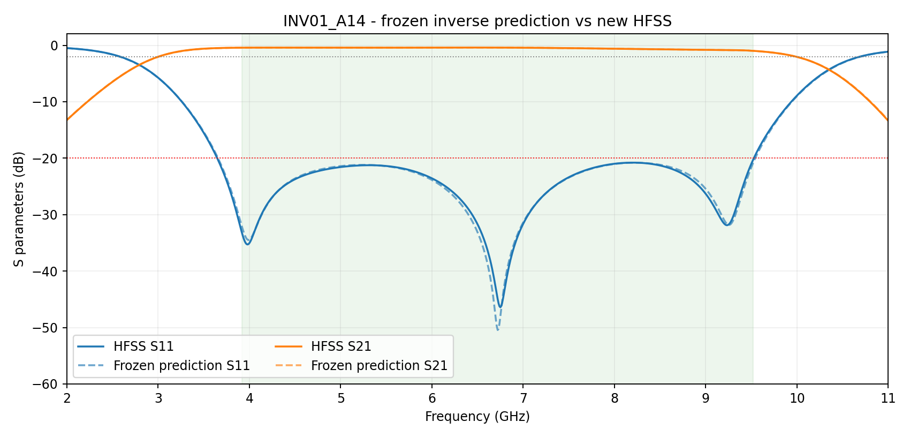

# Fig8 弯折微带与槽线过渡模型研究

截至 **2026-11-09** 的研究归档与离线复现包。目标是用独立理论坐标 **P/R** 解释弯折结构的响应，并从匹配与带宽要求反推几何，再由 HFSS 验证。**只包含弯折研究，不合并均匀模型数据。**

> 当前结论：已获得局部条件带宽关系、含实际长度的复数响应代理，以及一个真实 HFSS 名义通过的逆设计闭环。**尚不是任意指标都能可靠逆向设计的通用工具，也不是48项全部达标。**

## 先看哪些文件

|阅读目的|入口|
|---|---|
|完整研究总结、发现与局限|[研究总报告](docs/RESEARCH_SUMMARY.md)|
|各批次进度及不同“通过”口径|[时间线与状态](docs/TIMELINE_AND_STATUS.md)|
|P/R、几何、材料及评分定义|[理论与验收](docs/THEORY_AND_CRITERIA.md)|
|数据分组、训练和可移植运行|[离线复现](docs/REPRODUCIBILITY.md)|
|HFSS设置与hook工作方式|[仿真与完成通知](docs/SIMULATION_AND_HOOK.md)|
|尚未完成的工作|[后续研究建议](docs/OPEN_QUESTIONS.md)|
|所有历史阶段的报告和参考源码|[历史证据索引](docs/ARCHIVE_INDEX.md)|
|最新单例实测与预测|[冻结结果](results/inverse_case/FINAL_RESULTS.json)|

## 最新可核实结果

- 新48点**采集完成**：主窗通过5/48，不能当作逆设计成功率。
- 后续固定P/R调谐批次**仍暂停**：历史快照10/48名义通过、7项局部未解决、31项待处理。
- 最新模型：80条几何数据 = **78条开发 + 2条回顾性几何留出**；按24个宽度家族做嵌套分组验证。
- 同输出形式下，加入实际长度修正，最差S11家族均衡MAE从0.19025降至0.074845dB；仍有**2个假通过**。
- 新单例 `INV01_A14`：14核串行、103787网格、8次Analyze，完整3.92–9.52GHz主窗**名义插值通过**。
- 该点最差S11 **−20.2442dB**、最低S21 **−0.9829dB**；联合上沿距目标仅 **6.99MHz**，且距离已测几何约 **0.00321mm**。这是局部闭环验证，不是独立新家族泛化认证。



## 快速使用

Python 3.12，在仓库根目录执行：

```bash
python -m venv .venv
# Windows: .venv\Scripts\activate
# Linux/macOS: source .venv/bin/activate
pip install -r requirements.txt
python tests/test_research.py
python analysis/predict_response.py --Wm 1.9136201833872932 --Ws 0.34596701899421023 --Lm 6.584499793266415 --Ls1 12.619994699196244 --Ls2 1.2419340379884205 --Ls3 1.74596701899421
```

预测入口不启动HFSS，不发送消息；输入超出已支持的联合凸包会拒绝。输出 `HFSS_verified=false` 是正确行为：**预测不自动变成实测认证**。本次实测通过记录单独保存在 results。

## 文件结构

```text
analysis/        可移植、纯离线数学和预测/训练代码
model/           冻结数据、模型系数、分组结果与误判记录
results/         唯一新增逆向案例的冻结预测、实测与关闭记录
data/raw/        80条历史模型曲线 + 1条新逆向曲线及轻量证据
hfss/            INV01_A14原始AEDT工程，不含求解缓存
archive/         各历史阶段的报告、数据和参考源码（脚本为.py.txt）
tools/           通用hook 1.1.0源码，以及隔离的离线复现入口
docs/            总结、理论、复现、数值策略、索引和图表
provenance/      原文件/归档文件哈希、脱敏说明、范围及校验
```

## 安全和范围

研究归档不是整盘备份。未上传巨型结果缓存、Python环境、授权软件、论文PDF、桌面截图、活动通知队列和本机认证信息。历史聊天ID与用户路径已脱敏；原始哈希与脱敏后哈希分别记录，不能混为一谈。最终AEDT工程和曲线按原始字节保存。

历史运行脚本仅供审计，不能作为恢复授权。**克隆、运行离线分析或安装hook，都不表示允许重开旧批次。** 旧整批暂停，最新两个诊断分支与单例分支均已关闭。GitHub上传不启动任何仿真。

没有默认授予开源许可；研究资料及第三方引用的权利归原权利人。见 [权利说明](NOTICE.md)。
