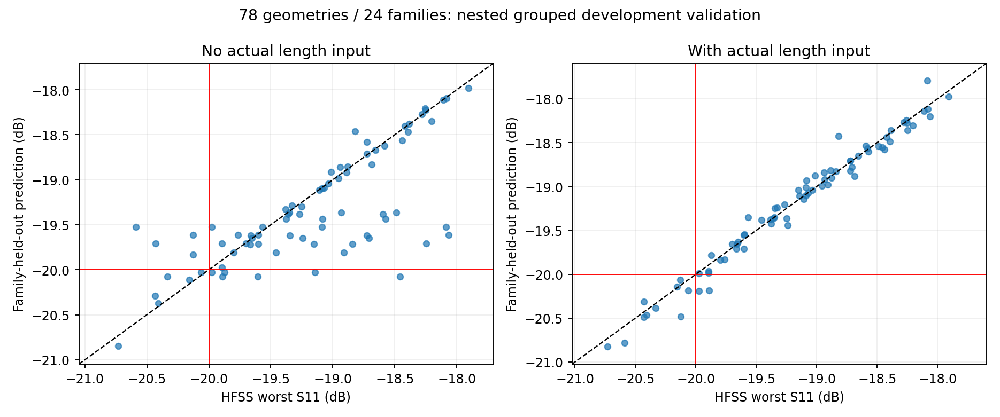

# 弯折模型研究总报告

## 研究问题与当前答案

研究对象是 Fig8 弯折微带/槽线垂直过渡，不是六极高阶结构，也不是均匀模型。希望做到两件事：一是用独立理论P/R解释带宽与匹配的变化；二是给定S11和带宽要求，输出尺寸并用HFSS验证。

目前已经完成**限定材料、间隔、折臂档位和样本域内的局部设计流程**。其中S21带宽规律较稳定，−20dB联合连续通带的可靠逆向设计仍受带边位置、峰值跨阈值及样本覆盖限制。不能靠把所有失败点调成通过来证明规律；失败点是可行边界和模型误差的重要证据。

## 从几何经验到理论坐标

早期24配置建立宽度经验式，后续6点和4点检验。在当时经中央谷/等峰调谐的34项数据中：

`BW_S21/GHz = 6.804574332 + 0.798166452 ln(Wm/1.20) + 0.866177522 ln(Ws/0.44)`

新增10点未参与拟合，平均误差10.392MHz、最大23.489MHz。该历史经验式有材料和调谐条件，不保证全部尺寸均合格；原24中8项历史网格超过11.2万，不能说全34项同网格。

随后建立独立传输线阻抗映射并用TXLINE已有实读结果核查。P=Zm·Zs/2500，R=Zm/Zs，不使用实测带宽反算P/R。18项受控P/R设计中，三个P×两个折臂共6组三点序列均表现为**固定P，R增大，S21带宽减小**；固定R时P增大，带宽增大。较差内峰的匹配变化与传输带宽存在取舍。

18项直接频点口径的局部式：

`BW_S21/GHz ≈ 4.163723 + 1.326952 lnP − 2.277862 lnR − 0.017813(a−1.6)`

留整P/R家族交叉验证MAE5.78MHz、最大17.33MHz。这是内部交叉验证，不是将来误差上界。18项所选几何均完成基准调谐，但16项整体数值一致性通过、2项未解决；只有6项的两内峰达到−20dB。不同口径不能混用。

## 为什么不能只拟合带宽

联合通带是S11≤−20dB与S21≥−2dB的**连续交集**。内峰稍微越过−20dB就可能把一个频带拆成多段。不能把中间不合格区跨过去相加，也不能用S21带宽代表联合带宽。

历史18点中仅约0.23dB的内峰误差，就导致某项联合带宽预测误差约1.404GHz。最新单例又表明，即使联合带宽总误差只有约6.36MHz，上沿位置仍可误差15.28MHz，造成最差S11误差0.5615dB。因此未来应分别建模或约束低边、高边、中央谷与匹配峰，而不是只追求总带宽MAE。

## 最新响应模型改进

80条独立几何经来源、曲线、ACK及数值检查，其中78条开发、2条已知结果的诊断几何回顾性留出。宽度家族的两种折臂、探针和候选整组进入同一折，避免近邻泄漏。外层6折、内层3折；预处理在训练折拟合，按家族均衡。

输入为 `[lnP, lnR, a, δLm, δLs1]`，后两项为实际长度减独立理论名义长度，不从响应反推。模型采用Ridge，不是神经网络。

|模型|家族均衡最差S11 MAE dB|假通过|漏通过|
|---|---:|---:|---:|
|A 无长度的指标模型|0.295256|3|8|
|B 有长度的指标模型|0.239514|3|7|
|C0 无长度的复数曲线模型|0.190250|6|4|
|C 有长度的复数曲线模型|0.074845|2|0|

同输出消融下长度特征降低最差S11误差60.7%。C的S21带宽家族均衡MAE为7.192MHz；联合区间连通分量判错4/78，中心联合段低/高边MAE约53.4/11.2MHz。两个假通过N11_A14、N20_A14_C1完整保留。

线性复数系数给出局部代理公式：

`S(f)=c0(f)+cP(f)lnP+cR(f)lnR+ca(f)a+cm(f)δLm+cs(f)δLs1`

当前78条开发数据的描述性条件式：

`BW_S21/GHz ≈ 3.832677 + 1.274825 lnP −3.035451 lnR +0.036529a −0.492526δLm −0.171736δLs1`

固定P、a及两项长度修正，R减小对应带宽增大。400次家族重采样R系数全部为负。**固定修正长度不等于固定绝对物理长度**；这是描述性经验关系，不是联合通带公式、因果定律或可跨材料使用的解析解。历史公式使用不同数据和长度条件，系数不能直接混拼。

## 一个真实闭环验证

用户允许调整P/R，但只验证一个新候选。候选在样本联合凸包内选出，仿真前冻结，不根据结果重拟合或换点。

|指标|冻结预测|HFSS实测|
|---|---:|---:|
|主窗最差S11 dB|−20.805704|−20.244202|
|主窗最低S21 dB|−0.987548|−0.982886|
|中央谷 GHz|6.72|6.75|
|内峰差 dB|0.384702|0.457824|
|S21带宽 GHz|6.973606|6.980019|
|联合连续带宽 GHz|5.886449|5.880086|

INV01_A14真实14核、103787网格、8次Analyze；完成hook被接收，独立审核并实际看图ACK后关闭。完整3.92–9.52GHz主窗名义插值通过。

但候选非常接近N20_A14_C2_TR1B，六尺寸欧氏距离仅0.003210mm；中央谷位于容差上边界，联合上沿裕量只有6.989MHz，S11裕量0.2442dB。因此只证明局部流程闭环，不证明宽域泛化、0.4dB缓冲、制造公差或直接频点认证。

## 尚未证明的机理

导师提出弯折降低槽线辐射边缘损耗、可能略减本征带宽。现有结果与该解释并不直接矛盾，但比较包含重新调谐，尚无隔离损耗来源的受控场/功率证据。S参数剩余功率不能全部叫辐射损耗。也不能由这些低阶结构推断高阶带内性能已得到保证。

## 证据入口

- [34项历史规律](../archive/fig8_laws_consolidated_20261026/REPORT.md)
- [18项理论P/R补点](../archive/fig8_PR18_delivery_20261027/REPORT.md)
- [最新分组指标](../model/METRICS.json)、[同输出消融](../model/CURVE_ABLATION.json)、[条件式](../model/CONDITIONAL_BW_LAW.json)
- [单例结果](../results/inverse_case/FINAL_RESULTS.json)、[带边诊断](../results/inverse_case/BAND_EDGE_DIAGNOSIS.json)
