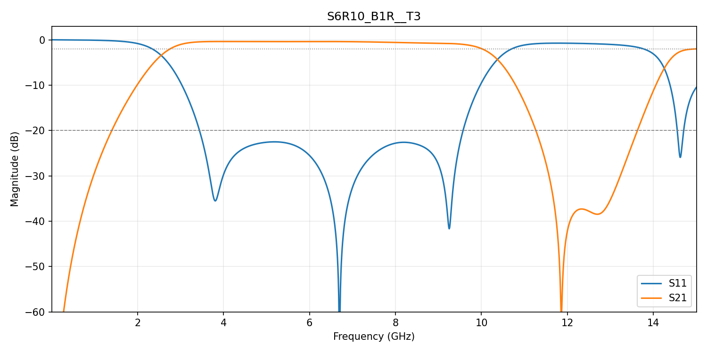

# R12 阶段6 R4：B1R名义调准；密网格触发安全停止

## 总结
**R4兼容修复已完成并在真实求解路径验证，B1R在3次内名义调准；但本轮未全部做完。** 密网格第27轮达到247,756单元，超过240,000安全上限，ΔS=0.0023507仍高于0.002；未提交最终扫频，未导出有效密网格S参数。按停止规则保留工程与缓存，停止C1R和6C，不放宽标准、不追加几何、不自动建R5。

**当前只有名义仿真设计，不能标为“统计稳健”或“最坏角点稳健”。** 所有结果均不含SMA接头和实际转接反射，不能等同制造合格率、实测或全模式功率认证。

累计 **193/200几何、1846次Analyze**；阶段6为20/27几何、213次请求。本R4新增4几何、39次，费用10+7+10+12；没有重复计算历史P10或任何已完成公差点。

## 1. R4工具修订与冻结
计划ead3d02；R4首次冻结225287a先于任何本轮Analyze。真实继承P1/P2配置走spec→make_input，完整重建fixed_milled_outline规范CAD，不只补字段；六尺寸、槽布尔盒及全对象物理包络与旧记录相同。八个新分支、正负蚀刻、旧P10拦截、预算、取消项和Ws固定a/g规则均有回归。47项修订离线回归及11项默认测试通过，默认归档8765项无错误。
四个实际启动几何分别在首次Analyze前完成独立零Analyze ValidateDesign并推送输出，worker又在首次Analyze前重复原生验证。全部无error；保留材料因果性建议warning，未擅自改材料或边界。Rad1仍是air_box的Radiation，板框±15/±25mm固定，端口截断面与高度8h/宽15.04mm规则不变。
R1/R2/R3的冻结、STOP、claim、marker、锁、账本均保持原字节；后验审计历史哈希4102项均一致。R12取消P1/P2密网格及旧C1，本轮从未创建它们的运行输入。

## 2. |Γ|余量与T1求解前预测
|量|冻结值|
|---|---:|
|蚀刻ΔΓ幅值|0.003835764832|
|εr ΔΓ幅值|0.001390400288|
|h ΔΓ幅值|0.020355007026|
|RSS|0.020759879957|
|网格增量（0.256dB）|0.002763814767|
|调参增量（0.1dB）|0.001069930695|
|Γ_req|0.075406374581|
|P_req|-22.451838778 dB|
|密网格统计判据|两内峰均≤-22.021097504 dB|

h0=.813mm，tol_h=±.038mm；N0=.077535dB≤.1，不加噪声。与审核方review_s6r3.py余量结果差0dB。采用反射系数增量叠加，不使用旧dB公式或−21.8dB跳过规则。
T1采用B1直测中心差分J，目标取许可区间中点−22.551839dB；Ws=.456、Lm=6.590、Ls1=12.544mm。两参数规律交叉解为.460/6.588/12.570mm，历史调参J替代解也原样冻结。与审核参考最大差.006mm；不是求解后选模型。T1是4–5步外推，后续只用冻结的有限Broyden规则。

## 3. B1R三次结果与最终尺寸
|项|中央谷GHz|低内峰dB|高内峰dB|BW20 GHz|带内最差S21 dB|网格|ΔS|Analyze|名义专用判据|
|---|---:|---:|---:|---:|---:|---:|---:|---:|---|
|T1|6.73|-22.418078|-22.677189|6.124026|-0.989513|100385|0.0015524|10|未通过|
|T2|6.73|-22.611391|-22.656026|6.120643|-0.989851|100085|0.0016140|7|未通过|
|T3|6.70|-22.507618|-22.605617|6.131644|-1.011653|103762|0.0021190|10|通过|

T1峰差.259111dB，低峰未深到目标；T2高峰比许可下界−22.651839dB更深.004187dB，严格保留“未调准”，未放宽窗口。T3两峰都在区间内、峰差.097999dB、中心谷6.70GHz、S21≥−2dB，专用稳健名义判据通过。
通用R7 classify针对−20.3dB等纹波规律目标，因此深纹波B1R的通用tuned=false；这不覆盖R12专用robust_nominal_pass=true。两种标签不能混用。

**最终名义尺寸（mm）**：Wm=2.350，Ws=.459，Lm=6.599，Ls1=12.545，Ls2=1.468，Ls3=2.259；a=1.800、g=.550，er=3.55、h=.813、tanδ=.0027、铜厚.035。蚀刻后的形状必须用规范CAD记录，不能只靠六参数近似。

## 4. 密网格：明确的数值停止，不是建模或设计失败
同一B1R T3几何另起独立进程和新工程，从头求解。第26轮226,858单元、ΔS=.0040312；下一轮设置PercentRefinement=5，实际第27轮247,756单元、ΔS=.0023507。细化百分比不等于实际单元数增长的硬上界，本次增长20,898（约9.21%）。冻结代码先检查24万安全上限，因此在第13次Analyze之前抛出NumericalStop。
超过上限7,756单元（3.232%），而且ΔS仍未过关；即使只容忍这次网格超限，也不能据此认为数值收敛。没有用旧源工程结果或自适应单频值冒充最终宽带扫频。12次请求都是自适应段，最终Sweep1始终关闭。
原生ValidateDesign、CAD包络、槽布尔盒、实际14核1组和全部12段进程角色均通过。此次不是R3元数据兼容问题复发，不是零Analyze几何相交；也不是单纯扫频超时。`SUMMARY.technical_failure=true`是收集器按failure.txt存在给出的通用标志，具体分类以RUN_RECORD.numerical_pass=false及堆栈为准。STOP内“R10数值停止”是沿用字段文字，不表示跑错计划。
工程model.aedt、model.aedtresults和全部失败记录保留。清理器仅释放本案例自有AEDT、恢复scratch设置；没有清工程锁或删除缓存。停止后核验无本批worker、HFSS或hf3d。

## 5. 两种稳健标注与预测评分
|预测|结果|依据|
|---|---|---|
|Q21|通过|T1均值变化-1.806420dB／目标-1.810626dB=99.768%，在70%–130%|
|Q22|通过|调准B1R的BW20=6.131644GHz，在6.10–6.30|
|Q23|不可判定|无有效密网格宽带结果，C1R未启动；不能填通过或零影响|
|Q24|不可判定|缺C1R，ΔΓ幅值未测|
|Q15|不通过|实测带宽损失323.278MHz／新增最高峰余量1.820970dB=177.531MHz/dB，超90–150|
|Q16|不可判定|6C被前序数值STOP阻止|

Q21支持所选实测J的大步均值预测，但不能证明两参数拟合在深纹波处仍普适。冻结两参数规律在T1/T2/T3的均值残差为+.182/+.129/+.121dB，倾斜变化残差为−.342/−.284/−.497dB；T2/T3的倾斜变化连符号也与该式相反。残差已大于原公差拟合的.055/.12dB RMS，说明公差尺度的优秀回归不能直接当作深纹波设计的通用公式。不能把“均值命中”说成全响应一次命中。逐点数值见stop_review/REVIEW.json/two_parameter_forward_checks。等效参数来自求解后的同一条曲线，这部分不是独立的几何→响应前瞻预测；没有用新数据回改预测或重拟合。
Q15只有一个B1/B1R对，中央谷还差30MHz，因此是本对点的观测价格，不是新普适斜率。Q11–Q20承接R12审核：Q11通过（浮点端点披露保留）；Q12不通过；Q13/Q14通过，Q14理由错误的修正保留；Q17–Q19通过；Q20不通过（旧dB余量−22.13在预测区间外）。
**统计稳健与最坏角点稳健均为“未验证”**，不是“已经失败”或“通过”。C1R本应采用e+.01、er3.50、h.775并加本设计自身密网格向上偏差；两项证据现在都不齐，不能使用B1旧密网格偏差替代B1R的新确认。

## 6. 6A公差规律汇总（继承有效观测，不复算）
h是现实误差中最强的一项；薄.038mm使高峰升到−18.957dB，完整−20dB主窗消失。Ws在四种独立±.02mm平面尺寸中最敏感；Lm主要移频、Ls1主要调倾斜。最高峰在两峰切换处有拐点，余量用两侧直测，不用J硬叠加。过蚀刻P9c最高峰升.353294dB，低于Ws单项.502913dB。er3.50/3.60主要移频+30/−40MHz。
h不能简单等价成微带阻抗宽度变化；R12指出槽线变比N2和失谐是更重要的解释。这是现有等效模型的证据，不是排除所有其他机理的因果证明。两参数公差规律的已有R² .983/.969及去h检验保留，但不把等效参数拟合与逆向交付认证混为一谈。
P9c与旧P9两峰差−.014934/+ .045053dB，含板框和重新剖分影响；N0=.077535dB使其不能被孤立解释为边界效应。旧P9只作不同外轮廓情形归档，余量用P9c。完整线性/J比较在R3报告及本轮JSON公差明细；P13 BW20缺失仍为null，不改写为0。

## 7. 预算、暂停位置与接续入口
|项|几何|Analyze|
|---|---:|---:|
|继承|189|1807|
|B1R T1/T2/T3|3|27|
|B1R密网格|1|12|
|本轮新增|4|39|
|累计|193/200|1846|
|阶段6|20/27|213|

本轮最多8几何，本次已用4；剩余名额只能是原定C1R、W3T4、W4最多2次，不能转给新的密网格几何或追加B1R T4。密网格同一物理几何12/20次请求已计；8次“尚未用完”不是自动恢复授权，也不能重置账本重开20次。
冻结与模型：freeze/R12_R4.json、freeze_6B/R10_2.json；数值失败：stop_review/dense_failure.txt、dense_RUN_RECORD.json、STOP.json；预算：stop_review/LEDGER.json；当前状态：CURRENT_STATUS.json。实际缓存位于本机独立runtime目录，路径见RECOVERY_REQUIREMENTS.md。
需要审核具体的密网格数值恢复方案与边界，再由人类明确授权；不能修改现有冻结、删除STOP、直接补扫频或擅自增大24万上限。当前ΔS不合格，直接补扫频并不能修复自适应精度。6C未测，Wm=2.50/2.65平台结论没有新证据。停止在这里，不进入阶段7。

## 8. 独立重放与证据完整性
共20份原生CSV（B1、16公差点、3个B1R）独立重放，两峰/中央谷/BW20最大绝对差3.552713678800501e-15。四个几何均实际14核、单组、串行，零Analyze预检与worker验证通过；名义三项最终扫频不改变自适应历史。冻结哈希和历史哈希全部核对一致。全部数据保持与均匀模型分离，不发hook或定时消息。
