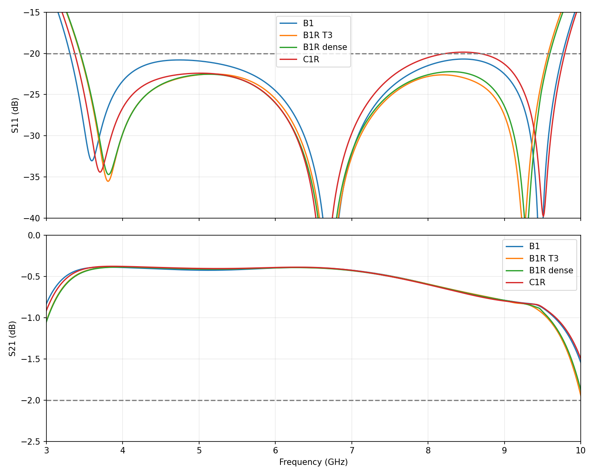

# R14：阶段6收尾报告

## 总结

已按R14完成有限R6修复和R13规定的三步流程（6C门槛通过，已完成W3 T4和W4 T1）。统计标注：**统计稳健（不含网格残差，边缘）**；联合角点：**最坏角点不满足**。
本轮新增3个几何、34次Analyze；累计196/200几何、1880次Analyze。阶段6累计23/27几何、247次Analyze。已停止；不进入阶段7。

## 1. 工具修复、验证与运行口径

R6冻结提交b397e33。只修观察器导入路径，capture函数AST与R5相同。10个入口×2种cwd的新解释器隔离导入、实际观察器ready/stop空跑均通过；R5失败复现和R6通过证据均保留。55项R5回归、55项R6回归、默认11项及8765归档文件校验通过。
首次未发布测试有两个适配问题：Windows venv启动器与真实解释器PID不同，现按创建时间和祖先链验证；默认测试需原有sklearn依赖路径，已恢复该测试环境。原失败输出保留。这些不是HFSS求解恢复。发布后的运行中自行修复0次，无求解重试。
原R4的597文件缓存重新复制，R5已打开副本未复用；新副本原生CAD、材料、端口、Rad1和全部27行历史核验通过。密网格只补1次扫频，同一物理几何12→13/20，新增自适应0轮；247756单元/ΔS=.0023507保持不变。观察到31个14核1组扫频角色，不是31次Analyze。
C1R及后续每个新几何均先零Analyze原生ValidateDesign并推送；普通网格与每几何预算未改。14核1组串行，无hook、无新增直接频点。R1–R5不改、不删，源缓存及冻结/历史哈希复核一致。

## 2. B1R交付与确认

名义尺寸(mm)：Wm=2.350，Ws=0.459，Lm=6.599，Ls1=12.545，Ls2=1.468，Ls3=2.259；a=1.8，g=.55。名义εr=3.55、h=.813、tanδ=.0027、铜厚=.035。C1R是在这套几何上联合施加真实铜边e=+.01mm、εr=3.50、h=.775mm；板框和端口截断面不动，端口高度8h、宽15.04mm。
|项目|中央谷 GHz|低内峰 dB|高内峰 dB|BW20 GHz|BW20内最差S21 dB|
|---|---:|---:|---:|---:|---:|
|B1基准|6.730000|-20.795778|-20.686649|6.454922|-1.109024|
|B1R名义T3|6.700000|-22.507618|-22.605617|6.131644|-1.011653|
|B1R密网格|6.680000|-22.528228|-22.218248|6.148618|-1.014523|
|C1R|6.640000|-22.403804|-19.848285|null|null|

统计阈值Γ_stat=0.079240120043；Γ_dense=0.077461803297，加入残差.0023507后=0.079812503297。不含残差通过=True；含残差通过=False。这不是自适应收敛证明。
自身网格偏差δ_mesh=max(0,Γ_dense−Γ_T3,max)=0.002538126825。C1R的Γ=0.101762028101，加偏差后=0.104300154926，要求≤0.1。
密网格两峰变化(dB)：{'low_peak_dB': -0.020610073912422422, 'high_peak_dB': 0.3873695612763086}；对应ΔΓ：{'low_peak_dB': -0.00017756982725411485, 'high_peak_dB': 0.0033787070603187863}。中央谷是否在6.69–6.75GHz：False，不为此追加T4。
联合角点C1R−名义B1R的ΔΓ=0.026838351629；三项单独扰动线性和=0.025581172146，RSS=0.020759879957。不把RSS当制造良率概率，不把本角点当全参数域的数学最坏点。
BW20为围绕指定中央谷的完整主窗；消失时写null，不拼接小窗口。S21列仅为BW20内离散样本，不混用BW15或其他窗口。名义/插值通过不等于制造保证。

## 3. 6A公差直测回顾

|点|中央谷 GHz|低内峰 dB|高内峰 dB|BW20 GHz|最差S21 dB|
|---|---:|---:|---:|---:|---:|
|P1|6.700000|-20.617862|-20.183736|6.513369|-1.136259|
|P2|6.750000|-21.106149|-21.304820|6.398015|-1.081322|
|P3|6.690000|-21.066519|-20.453018|6.455952|-1.117014|
|P4|6.760000|-20.489874|-21.115386|6.451466|-1.089810|
|P5|6.730000|-20.565860|-20.788646|6.445832|-1.107978|
|P6|6.730000|-21.143491|-20.373448|6.466975|-1.108644|
|P7|6.720000|-21.013231|-20.670778|6.459958|-1.112617|
|P8|6.730000|-20.555869|-20.413870|6.454700|-1.112961|
|P9c|6.720000|-20.652510|-20.333355|6.499554|-1.129074|
|P10|6.730000|-20.697670|-20.998772|6.412218|-1.076565|
|P11|6.760000|-20.556919|-20.557712|6.496827|-1.123719|
|P12|6.690000|-20.690247|-20.914094|6.412154|-1.085472|
|P13|6.640000|-20.396280|-18.957356|null|null|
|P14|6.820000|-20.855795|-22.725784|6.273163|-1.037898|
|N0|6.720000|-20.685420|-20.609114|6.455622|-1.109529|

各点相对B1的完整差分、逐指标非线性判定和冻结J对照见[逐点附表](DETAILS_6A_J_AND_W4.md)，机器可读值见RESULTS.json。规则不变：|Δ+ + Δ−| > 0.5|Δ+ − Δ−|记明显非线性；有null不评分。后续余量使用两侧直测，不用J替代。P9c替代板框偏置不合规则的旧P9；不把旧P9合入新公差估计。
最高内峰升幅排名：h 1.729293dB > Ws 0.502913dB > etch 0.353294dB > Ls1 0.313201dB > Wm 0.272779dB > Lm 0.233631dB > er 0.129730dB。
现实来源蚀刻/εr/h：ΔΓ={'etch': 0.0038357648317449977, 'er': 0.0013904002880919253, 'h': 0.020355007025829708}；RSS=0.020759879957；Γ_req=0.075406374581，P_req=-22.451839dB。保守独立尺寸/εr/h线性相加升幅=3.181546dB，仅报告、不作为本轮设计目标。
P1/P2密网格和原C1已由R12取消，本轮没有重启。N0噪声约.0775dB，低于.1dB噪声追加线，不增余量。

## 4. 6C与预测评分

|设计|规律可用|两内峰均≤−20dB|中央谷 GHz|BW15* GHz|BW20 GHz|
|---|---|---|---:|---:|---:|
|W3|True|True|6.710000|6.961992|6.654536|
|W4|True|True|6.740000|7.123408|6.807338|

Q16：落入6.90–6.99GHz预测区间。W3是T1–T3之后的调参T4，不是独立盲测；W4首次候选才是冻结前瞻点，后续修改属于调参。不可用点不纳入带宽平台拟合。
归一化BW15*的有限差分斜率：B1(2.35mm)→W3(2.50mm)=0.918368GHz/mm；W3→W4(2.65mm)=1.076113GHz/mm。原冻结线性斜率1.167821GHz/mm。斜率减小只说明该区间增益减缓，不等于已经完全饱和；不拿BW20与BW15*混比。
本轮W4 T1即通过，未创建/派发T2。W3→W4的增益仍明显，且局部斜率高于B1→W3，因此不能宣称“斜率单调下降”或“2.65mm已到平台”。
各次候选的冻结预测、[中央谷,D,内峰均值]实测与数据角色详见RESULTS.json/platform_trials_and_frozen_predictions。T1目标参数拟合不是独立的全响应代理模型，不把给定目标当作已被证明的全响应预测。
|预测|评分|证据|
|---|---|---|
|Q11|通过，保留浮点端点披露|高峰中心差分和Lm移频量级，继承R12审核|
|Q12|不通过|实际蚀刻最高内峰损伤小于单改Ws|
|Q13/Q14|通过|εr主要移频；h是现实三项中主导来源|
|Q15|不通过|B1→B1R名义约177.53MHz/dB，不在90–150|
|Q21/Q22|通过|J大步均值达到目标99.8%；B1R名义BW20=6.1316GHz|
|Q16|通过|{"assessable": true, "passed": true, "BW15_star_GHz": 6.96199158536108, "conclusion": "落入6.90–6.99GHz预测区间"}|
|Q23|通过|{"assessable": true, "passed": true, "statistical_without_residual": true, "corner_highest_dB": -19.848284923799334}|
|Q24|通过|{"assessable": true, "passed": true, "dGamma": 0.02683835162938676}|
|Q25|通过|{"assessable": true, "passed": true, "highest_dB": -22.21824793869314, "own_delta": 0.00253812682534911, "label": "统计稳健（不含网格残差，边缘）"}|
|Q26|通过|{"assessable": true, "passed": true, "center_GHz": 6.68}|

## 5. 规律的适用范围与实物含义

两参数P_eff/失谐规律只在公差尺度的小扰动成立：原局部R²约.983/.969，适合公差估计、微调；不是一步完成深纹波大幅逆向设计的通用公式。B1R T1–T3均值残差+.18/+.13/+.12dB、倾斜残差−.34/−.28/−.50dB，T2/T3倾斜变化符号也与该式不同。大改动依靠实测J外推和有限Broyden修正，不用这些新数据事后改原预测。
名义B1→B1R最高内峰加深1.821dB，BW20减少323.28MHz（约5%）；这一个点对且中央谷不同，不能据此宣称普适178MHz/dB斜率。
若要在本轮两套尺寸中选更有反射余量的名义加工起点，可用B1R T3，但必须连同上面的统计边缘/角点标签交付，不能称为全公差保证。模型不含SMA接头，实物会叠加连接器与转接反射。板厚是主导误差；取得板厂或实测h0/tol_h后，可用P13/P14直测灵敏度离线重估余量，无需为这一步线性估算新增仿真，但该估算不是新的制造认证。

## 6. 停止与归档

本轮已到有限流程末尾，全部自有worker/HFSS退出、scratch还原；没有定时任务或hook继续派发。不自动建立R7、不进入阶段7，剩余额度不转作新授权。
原生曲线、独立提取、实际看图ACK、角色证据、CAD/验证及预算均在本目录results/、validation/、pre_solve/及final/。运行中工具补丁恢复列表为空；没有改变判据或掩盖失败。

## 7. 最终复核与文档修订披露

收尾再次通过R5 55项、R6 55项、默认11项、8765文件校验，以及20次全新解释器导入和2次实际观察器空跑。最终4套结果清单、597文件原R4缓存及冻结/历史哈希复核一致。详见POST_TESTS.json和FINAL_AUDIT.json。

报告生成阶段修过两个离线展示问题：W3预测为列表而W4为对象，现保留原预测并统一显示；NumPy布尔值现转为标准JSON布尔值。未发布错误中间稿DRAFT_RESULTS_SERIALIZATION_ISSUE.json仅保留审计，**正式科学结果只认RESULTS.json**。这两项没有改运行代码或冻结输入，没有新增Analyze，不是R14运行中技术重试。

W4首次候选相对冻结预测：中央谷+19.397MHz、两内峰差−0.168986dB、均值−0.088825dB；BW15*相对主要线性预测−47.278MHz、相对预登记二次备选−23.208MHz。详见逐点附表。

已写入正常完成STOP和COMPLETED标记，禁止继续派发。STOP不是技术故障，也不是用户暂停；闭账详情见CLOSURE.json。剩余额度不自动使用。RESULTS.json中的预算为生成报告时快照，最终停止状态以CURRENT_STATUS.json和CLOSURE.json为准。
