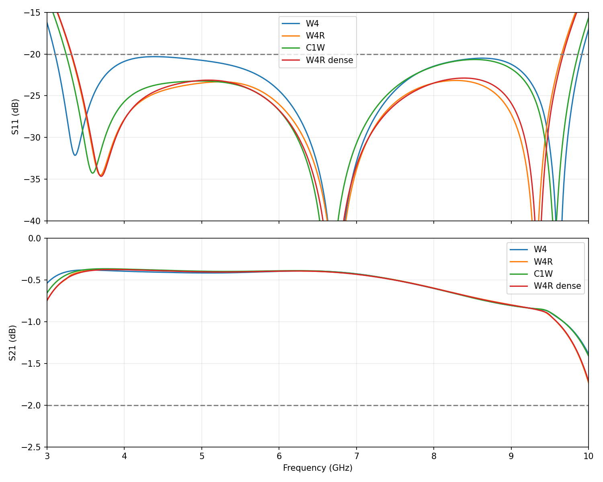

# R15：阶段7 W4R稳健交付报告

## 总结

有限流程已完成。名义调准：True；密网格：**统计稳健（含网格残差）**；联合角点：**最坏角点稳健**。
新增4/6几何、43次Analyze；累计200/202几何、1923次Analyze。14核1组串行。做完停止，不进入阶段8。

**预测不是全部通过：** Q27、Q28、Q29通过；Q30因密网格中央谷下移40MHz而不通过（预测10–30MHz）。两峰Γ变化的分项仍落在预测条件内。这个频移不改变按R15 Γ域判据得出的两项稳健标注，也不代表密网格仍满足名义等纹波调参窗。



## 1. 冻结与执行

R7冻结提交f52cc0c；R1–R6不改。观察器继承R14修复，R6原55项、R7新34项、默认11项、8765文件归档和20次独立解释器导入/2次观察器空跑通过。每个新点先零Analyze原生ValidateDesign并推送，再发布绑定后启动；逐点独立看图ACK。
默认h0=.813mm、tol_h=.038mm、角点档。Γ_req=0.069554000，P_req=-23.153557780dB，目标中央谷6.72–6.75GHz，纹波窗[P_req−.2,P_req]。S21以完整BW20主窗的原生样本最小值验收。
未选用的±.025mm角点表项与公式差.005221dB，已在冻结披露；默认行误差.003558dB满足计划精度。用户随后明确确认“以公式为准，披露差异并继续默认输入”，见USER_CLARIFICATION_P_REQ.json；没有回写旧冻结或更改参数/预算。
T1同时冻结B1实测中心差分J与邻近W3 Broyden代理J的解，选择前者。W4没有独立局部扰动J，未冒称实测W4 J。T2–T4采用原有限Broyden。候选均是调参数据，不是新的独立盲测集。

阶段6的15个扰动、灵敏度排序、现实/保守余量、J对照和Q11–Q26评分继续以[阶段6报告](../../fold_bandwidth_r14_stage6_r6_20261116/final/REPORT.md)及其附表为准，本轮没有重算或改写。

## 2. 交付对比

|设计|中央谷 GHz|低峰 dB|高峰 dB|BW20 GHz|BW20内最差S21 dB|
|---|---:|---:|---:|---:|---:|
|B1名义|6.730000|-20.795778|-20.686649|6.454922|-1.109024|
|B1密网格|6.700000|-20.669701|-20.430824|6.466249|-1.115789|
|B1R名义|6.700000|-22.507618|-22.605617|6.131644|-1.011653|
|B1R密网格|6.680000|-22.528228|-22.218248|6.148618|-1.014523|
|B1R角点C1R|6.640000|-22.403804|-19.848285|null|null|
|W4名义|6.740000|-20.310683|-20.493296|6.807338|-1.242781|
|W4R名义|6.740000|-23.324131|-23.164198|6.340182|-1.066431|
|W4R角点C1W|6.640000|-23.235210|-20.654737|6.616410|-1.186732|
|W4R密网格|6.700000|-23.127475|-22.876870|6.353700|-1.083499|

B1角点C1已按R12取消，无直测值；B1名义和密网格仅名义−20dB通过，现实公差余量不足。B1R旧密网格和角点标注以R14报告为准：B1R统计边缘通过、最坏角点不满足。W4没有单独密网格/角点结果，不用W4R结果冒充W4认证。
W4R最终尺寸(mm)：{"Wm": 2.65, "Ws": 0.539, "Lm": 6.58, "Ls1": 12.765, "Ls2": 1.628, "Ls3": 2.339}；名义a=1.8、g=.55。

## 3. 角点与密网格判定

C1W在选定W4R上施加e=+.01mm、εr=3.50、h=.775mm；板框和端口截断面不动，高度8h、宽15.04mm。
密网格重新自适应；200k且ΔS<=.002即可扫频，220k强制转扫频并计残差，>300k严格停止。实际原生历史、计费和角色见逐点记录；强制转扫频不是收敛证书。
统计分档：Γ_dense+实测ΔS<=Γ_stat为含残差通过；只满足Γ_dense<=Γ_stat为边缘档；否则不满足。Γ_stat=.1−RSS。
对照文件中的design_pass/nominal_check是名义调准条件（中心和等纹波），不等于公差稳健判定；C1W与密网格的最终标注只按本节Γ域条件计算。
角点要求Γ_C1W+δ_mesh,W4R<=.1；自身偏差=max(0,Γ_dense−Γ_nominal,max)，缺失时仅借用B1R的.002538并注明未经本设计确认。
数值判定：

```json
{
  "statistical_label": "统计稳健（含网格残差）",
  "Gamma_dense": 0.07180529969994436,
  "DeltaS_residual": 0.0015825,
  "Gamma_stat": 0.07924012693185294,
  "own_nonnegative_mesh_dGamma": 0.0023364485360347076,
  "corner_bias_used": 0.0023364485360347076,
  "corner_bias_source": "own_W4R",
  "Gamma_C1W": 0.09273915962408466,
  "corner_Gamma_plus_bias": 0.09507560816011937,
  "worst_corner_robust": true,
  "worst_corner_label": "最坏角点稳健",
  "corner_minus_nominal_dGamma": 0.023270308460175013,
  "dense_center_shift_MHz": -40.000000000000036,
  "dense_peak_changes_dGamma": {
    "low_peak_dB": 0.0015617574861320621,
    "high_peak_dB": 0.0023364485360347076
  },
  "not_connector_or_manufacturing_certificate": true
}
```

密网格实际为212,371单元、26轮，ΔS=0.0015825，满足200k且ΔS≤.002分支；本次没有使用220k强制扫频兜底。角点加自身网格偏差后Γ=0.095075608<.1；统计项Γ_dense+ΔS=0.073387800<Γ_stat=0.079240127。

C1W相对名义的Δ|Γ|=0.0232703，比借用的B1R实测0.0268384低约13.29%；本次迁移估算偏保守。角点稳健只对应指定三项组合和给定Γ域加和规则，不代表所有公差组合和连接器都获得认证。

## 4. 调参与预测评分

|尝试|中央谷 GHz|低峰 dB|高峰 dB|BW20 GHz|R15调准|
|---|---:|---:|---:|---:|---|
|S7R15_W4R__T1|6.730000|-23.067884|-22.835761|6.390525|False|
|S7R15_W4R__T2|6.740000|-23.324131|-23.164198|6.340182|True|

原文Q27–Q30保存在freeze/R15_R7.json。未调准的候选不能拿来证明“调准W4R”的Q27。
|预测|评分|数值|
|---|---|---|
|Q27|通过|{"assessable": true, "passed": true, "BW20_GHz": 6.340182363902526}|
|Q28|通过|{"assessable": true, "passed": true, "dGamma": 0.023270308460175013}|
|Q29|通过|{"assessable": true, "passed": true, "selected_ordinal": 2, "nominal_tuned": true}|
|Q30|不通过|{"assessable": true, "passed": false, "center_shift_MHz": -40.000000000000036, "peak_changes_dGamma": {"low_peak_dB": 0.0015617574861320621, "high_peak_dB": 0.0023364485360347076}}|

所有候选的冻结预测、实测和残差见RESULTS.json/trials；保留未达标记录，不改原预测。

## 5. 带宽规律与加工推荐

6C表明Wm从2.35→2.50→2.65mm，归一化BW15*局部斜率约.918和1.076GHz/mm，尚不能宣称平台。稳健纹波加深损失BW20；加宽Wm带来的增益与该损失必须分别比较，不混用BW15*。
W4→W4R的BW20损失467.156MHz；W4R相对B1R名义BW20增益208.538MHz。这是本轮有限点对，不是普适MHz/dB常数。
推荐以本轮W4R选定版本作为名义加工起点，并附带全部公差与网格证据。
结果不含SMA接头，板厚仍是主导误差；即使本轮角点通过也只是已建模范围内的仿真证据，不是制造良率认证。

## 6. 后续实测板厚如何离线更新

取得h0/tol_h后，先按P13/P14分别在Γ域计算两侧斜率（以各自实测减B1除以±.038），不要把中心频率和峰高混用；围绕.813用对应侧估算名义厚度偏移，再按tol_h缩放h项。当前角点ΔΓ中扣除旧h项.020355，加入新h项；蚀刻/εr项保留。统计档则对现实三项重算RSS。结合本次C1W−W4R实测ΔΓ对跨设计灵敏度转移作校验，记录不一致量。
然后重算Γ_req、P_req以及现有设计余量，只做离线估算，不自动新增仿真；超出已测h区间或明显非线性时标注外推，不当作制造认证。

## 7. 停止与交付

原生曲线、校验、实际看图ACK、逐次Analyze与冻结均已归档。本轮运行中技术自修复次数为0；若发生异常，必须以真实单独故障报告为准。剩余预算不是新授权；不自动进入阶段8。

### 本轮成本明细

|算例|Analyze请求|单元|自适应轮数|ΔS|
|---|---:|---:|---:|---:|
|S7R15_W4R__T1|10|100229|24|0.0017354|
|S7R15_W4R__T2|11|103778|25|0.0020857|
|S7R15_C1W__T1|10|102368|24|0.0016098|
|S7R15_W4Rdense__T1|12|212371|26|0.0015825|

### 离线复测记录说明

首次收尾复测包装器误用了冻结期的ENTRY_TESTS_R7.json输出路径，独占写保护以FileExistsError拒绝；原冻结未改。失败记录保存在POST_TESTS_INITIAL_WRAPPER_FAILURE.json。改为新的final/ENTRY_TESTS_POST_RUN.json后重新执行入口/空跑测试；此项仅离线报告路径修正，不是求解错误或运行工具自修复，没有新增Analyze。

## 最终复核

收尾离线测试、归档校验、独立解释器导入和观察器空跑均通过。各点角色、看图ACK、原生结果清单、串行时间区间及全部冻结/历史哈希均已核对。已写入正常完成STOP及COMPLETED；这不是技术故障或用户暂停，不得自动接续阶段8。详见POST_TESTS.json、FINAL_AUDIT.json和CLOSURE.json。
