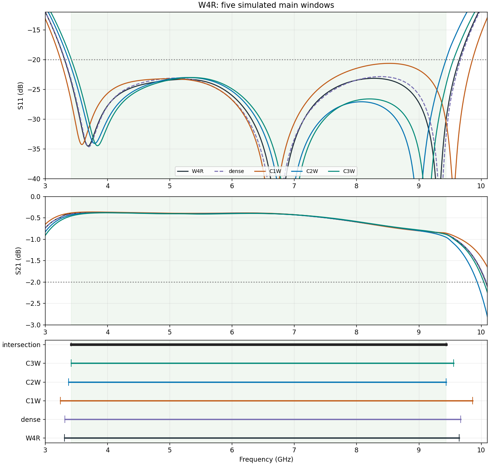
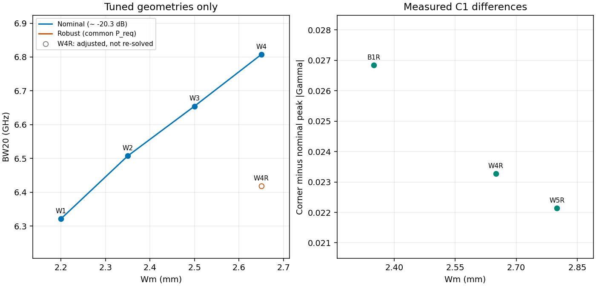

# Fig. 8 弯折过渡：阶段 8 交付报告（R16）

## 结论

**W4R 五条 HFSS 曲线的 −20 dB 交集：3.421–9.439（宽 6.018） GHz。** 低端由 C3W 限定，高端由 C2W 限定；两个新角点的四个带边相对冻结线性预测最大偏差 12.9 MHz。
**建议加工起点：W4R。** W4R 有自己的密网格和三种联合角点证据。
本轮占用 6/10 个几何尝试槽，其中 5 种不同的 HFSS 配置；61/140 次实际 Analyze。累计计费 206/212 个几何槽、1984 次实际 Analyze。未用额度不另作新授权。

## 1　−20 dB 带边与五曲线交集

带边是在 dB 域线性插值得到的、包含中央谷的连续主窗边界；不是所有子带的外包络。BW20 另要求此连通分量覆盖两个内峰，若分裂则报告空值，不填零。S21 取完整 BW20 窗口内原生扫频样本的最小值。独立从复数 CSV 与 NPZ 重算并核对了每条可用曲线。

|曲线|中央谷 GHz|低峰 dB|高峰 dB|BW20 GHz|最低 S21 dB|低边 GHz|高边 GHz|角点 Γ + 网格偏差|
|---|---|---|---|---|---|---|---|---|
|W4R 名义|6.740|-23.324|-23.164|6.340|-1.066|3.31131|9.65149|不适用|
|W4R 密网格|6.700|-23.127|-22.877|6.354|-1.083|3.31791|9.67161|不适用|
|C1W|6.640|-23.235|-20.655|6.616|-1.187|3.24657|9.86298|0.095075 / 通过|
|C2W|6.860|-23.029|-27.099|6.063|-0.950|3.37522|9.43868|0.072896 / 通过|
|C3W|6.930|-23.035|-26.619|6.138|-0.984|3.42057|9.55862|0.072850 / 通过|

C2W：e=−0.010 mm、εr=3.60、h=0.851 mm；C3W：e=−0.010 mm、εr=3.50、h=0.851 mm。C1 系列：e=+0.010 mm、εr=3.50、h=0.775 mm。板框和馈线端口截断面均固定，高度 8h、横向宽 15.04 mm。W4R 用自身测得的网格项 0.002336。

五曲线交集不是全公差立方体、全部八角或实际生产良率的证明。工艺误差仍有未直接求解的组合。

## 2　带边移动能否相加？

基准为 W4R 名义。单位 MHz；残差 = 实测 − 冻结线性预测。C1 薄板项的高端缺少可比的完整带边，不虚构预测值。

|角点|低边预测|低边实测|低边残差|高边预测|高边实测|高边残差|
|---|---|---|---|---|---|---|
|C1W|-62.0|-64.7|-2.7|—|211.5|—|
|C2W|58.0|63.9|5.9|-209.0|-212.8|-3.8|
|C3W|103.0|109.3|6.3|-80.0|-92.9|-12.9|

**低边：**两项残差均不超过 30 MHz，可在相近几何、材料和公差范围内用相加法做初估，不必为了初估重跑这两点；认证不在此结论内。

**高边：**两项残差均不超过 30 MHz，可在相近几何、材料和公差范围内用相加法做初估，不必为了初估重跑这两点；认证不在此结论内。

## 3　Wm 加宽后的名义带宽与稳健交付

默认 h=0.813±0.038 mm；Γ_req=0.073324、P_req=-22.695077 dB。峰值窗 [-22.8951,-22.6951] dB，|D|≤0.2 dB，中央谷 6.73–6.75 GHz，完整 BW20 内 S21≥−2 dB。a=1.8、g=0.55 mm；Ls2=2Ws+g，Ls3=Ws+a。

|设计 / 名义状态|中央谷 GHz|低峰 dB|高峰 dB|BW20 GHz|最低 S21 dB|Γ角点+偏差|保证带 GHz|
|---|---|---|---|---|---|---|---|
|B1R / 上阶段目标|6.700|-22.508|-22.606|6.132|-1.012|C1R: 0.104300（不通过，自身）|未测；C1R 完整主窗断开|
|W4R / 上阶段目标|6.740|-23.324|-23.164|6.340|-1.066|C1W: 0.095075（通过，自身）|3.421–9.439（宽 6.018）（五曲线交集）|
|W5R / 未调准的最近候选|6.710|-22.564|-22.654|6.569|-1.142|C1W5: 0.098913（通过，借用）|3.297–9.544（宽 6.247）；未直测，按 W4R 带边移动估算|
|W6R / 未运行/无有效值|—|—|—|—|—|C1W6: —（不可判，借用）|未运行，无名义曲线可供估算|

C1W5 实测：[中央谷、低峰、高峰、BW20、最低 S21] = 6.630 / -22.290 / -20.303 / 6.843 / -1.275；网格项借用 W4R，不是本设计密网格结果。

C1W6 实测：[中央谷、低峰、高峰、BW20、最低 S21] = — / — / — / — / —；无测量值。

B1R 密网格统计档边缘（未含残差），C1R 的 Γ 加自身网格偏差为 0.10430，不满足 0.1。W4R 自身密网格统计档含残差通过，C1W 为 0.09508；其他实测角点见表 1。较宽设计的保证带估算：把 W4R 交集相对名义的两侧收缩量分别转移，再与该设计已测 C1 主窗相交。若未调准，不作为稳健曲线样本。

**推荐版名义尺寸（mm）**：Wm=2.650，Ws=0.539，Lm=6.580，Ls1=12.765，Ls2=1.628，Ls3=2.339；a=1.800，g=0.550。仿真未含 SMA 接头；板厚是既有工艺考察中影响内峰最大的误差，不要用插值扫频和少数角点代替加工良率认证。

### 两条 BW20–Wm 曲线

W4R 的旧目标 -23.1536 dB，按 0.170 GHz/dB 换算到共同目标 -22.6951 dB，得到 6.41812 GHz（估算，不是重算）。名义组为约 −20.3 dB，不人为把 B1 的不同纹波当作同一条曲线。

名义组：W1 (2.20 mm, 6.3213 GHz)；W2 (2.35 mm, 6.5074 GHz)；W3 (2.50 mm, 6.6545 GHz)；W4 (2.65 mm, 6.8073 GHz)。
相邻区间斜率（GHz/mm）：2.20→2.35: 1.240；2.35→2.50: 0.981；2.50→2.65: 1.019。

稳健组：W4R (2.65 mm, 6.4181 GHz)。
相邻区间斜率（GHz/mm）：不可估计。
同一稳健目标下可比较的相邻区间不到两个，不能判断斜率是否递减或平台出现在哪里。

C1 相对名义的实测 Δ|Γ|：B1R 0.026838；W4R 0.023270；W5R 0.022138；W6R —。这只描述已测宽度及组合，不能外推为普适单调律。

## 4　预登记预测与顺序门槛

Q31–Q35 原文见 [求解前冻结](../freeze/R16_R8.json)。所有合取条件均需满足；测量缺失与预测失败分别记录。

|预测|评分|对照条件|
|---|---|---|
|Q31|通过|C2W 双边、带宽及双峰全部满足|
|Q32|通过|C3W 低边与带宽同时满足|
|Q33|通过|五曲线交集宽度|
|Q34|不通过|≤3 次调准且带宽落在预测区间|
|Q35|通过|配对角点 Δ\|Γ\| 区间且计网格偏差后通过|

W5R 的最近候选 T1：中央谷 6.71 GHz，纹波峰 -22.564/-22.654 dB。带宽落入区间不等于调准；Q34 仍不通过。C1W5 是此候选的联合角点测试，即使 Q35 通过，也不能据此开放 W6R 或宣称 W5R 完成稳健调准。

C2W：已完成规定角点；选定 S8R16_C2W__T1。

C3W：已完成规定角点；选定 S8R16_C3W__T1。

W5R：finite budget exhausted；选定 S8R16_W5R__T1。

C1W5：已完成规定角点；选定 S8R16_C1W5__T1。

W6R：W5R not tuned；选定 无。

C1W6：W6R not tuned；选定 无。

## 5　实际尝试、预算和证据

|算例|中央谷 GHz|低峰 dB|高峰 dB|BW20 GHz|最低 S21 dB|网格|ΔS|Analyze|名义调准|
|---|---|---|---|---|---|---|---|---|---|
|S8R16_C2W__T1|6.860|-23.029|-27.099|6.063|-0.950|104151|0.001350|10|角点对照|
|S8R16_C3W__T1|6.930|-23.035|-26.619|6.138|-0.984|103748|0.001394|11|角点对照|
|S8R16_W5R__T1|6.710|-22.564|-22.654|6.569|-1.142|100546|0.001367|10|不通过|
|S8R16_W5R__T2|6.760|-22.718|-23.147|6.561|-1.127|103282|0.001370|10|不通过|
|S8R16_W5R__T3|6.760|-22.718|-23.147|6.561|-1.127|103282|0.001370|10|不通过|
|S8R16_C1W5__T1|6.630|-22.290|-20.303|6.843|-1.275|102556|0.001259|10|角点对照|

**执行偏差：W5R 三次付费尝试实际只有两种名义几何。** 第三次 T3 与 T2 的冻结 CAD、材料和端口指纹相同，原生验证与输入相符，均为独立冷启动且结果一致；T3 不是独立设计点。两次原始证据均保留，重复尝试的 10 次 Analyze 全额计入，没有补做第四次。

原因：以最大归一化误差选基点，T1=3.000、T2=3.515，程序仍取 T1；T2 两个纹波分量的预测改变量为 +0.098 和 −0.183 dB，均未触发冻结的 >0.3 dB 雅可比更新条件，故提议返回同一尺寸。派发时仅检查算例编号，没有按最终 CAD 指纹去重。这是调参/调度的局限，不是 HFSS 未响应尺寸修改，也不能判 2.80 mm 物理不可达。下一版应在验证及计费前按尺寸、材料、端口和数值设置去重；相同候选应停止或按另行预先批准的规则选不同候选。本阶段没有改写冻结控制器。

每次 T1 及后续尝试的预测、三维响应残差、实际几何和独立验证的提交均在 [RESULTS.json](RESULTS.json)；未改原盲测，不把调参样本算作新独立测试。新几何按零 Analyze 原生验证、绑定发布、14 核单组串行求解、终态和实际看图记录分别归档。

阶段 6 的逐点扰动、B1 差值、线性与 Jacobian 对照、现实/保守公差和 Q11–Q16 的原始评分不因本阶段修改。参阅[阶段 6 中文报告](../../fold_bandwidth_r14_stage6_r6_20261116/final/REPORT.md)与[阶段 7 对照](../../fold_bandwidth_r15_stage7_r7_20261116/final/REPORT.md)。本轮未新增密网格、直接频点或连接器测试。

本报告到阶段 8 为止，剩余额度不转入新阶段。闭账证据：[FINAL_AUDIT.json](FINAL_AUDIT.json)、[CLOSURE.json](CLOSURE.json)。
