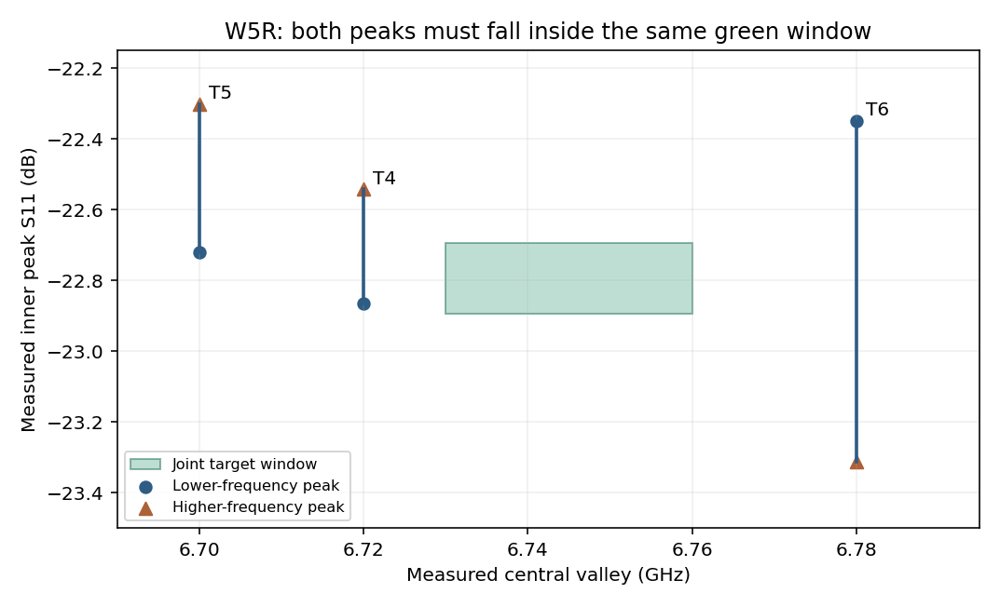
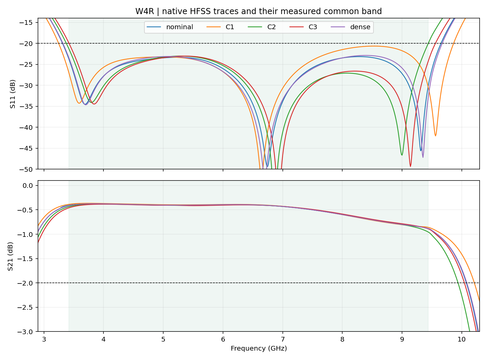

# 阶段 9 收尾：三个不同的 W5R 均未调准，保留 W4R 交付件

**结论。** 默认板厚 **0.813 ± 0.038 mm**。R9 五项回放全部通过，冻结提交 `a28c28b` 先于任何原生设计验证及求解。W5R 的 T4、T5、T6 均完成 HFSS 并通过数值审核，−20 dB 名义带宽为 **6.579–6.597 GHz**，但没有一次同时调准中央谷与两个内峰。按 R17 §3.2 到 T6 即停。**没有进入 9C 或 9D，没有求解 W6R、W7R、新角点或密网格。**

**推荐加工起点仍是 W4R**，不是本阶段新选出的设计。W4R 五条仿真曲线的共同 −20 dB 通带为 **3.42057–9.43868 GHz，宽 6.01811 GHz**。不能拿 W5R 的单条名义带宽与这个五曲线交集直接比较，也不能据此声称 2.80 mm 处出现带宽平台。

## 1　为什么停在 W5R

P_req = −22.695077 dB；目标中央谷为 6.74 GHz，验收窗 6.73–6.76 GHz；**每个内峰**须落在 [−22.895077, −22.695077] dB 内，|D| ≤ 0.2 dB，主窗内 S21 ≥ −2 dB。D 是高频峰减低频峰。

|尝试|Ws / Lm / Ls1（mm）|中央谷（GHz）|低 / 高频峰（dB）|D（dB）|BW20（GHz）|主窗最低 S21（dB）|
|---|---|---:|---|---:|---:|---:|
|T4|0.630 / 6.526 / 12.839|6.72|−22.865 / −22.544|+0.322|6.5913|−1.156|
|T5|0.634 / 6.535 / 12.839|6.70|−22.720 / −22.303|+0.417|6.5973|−1.161|
|T6|0.631 / 6.512 / 12.856|6.78|−22.350 / −23.312|−0.962|6.5787|−1.137|

Wm = 2.80，Ls2 = 2Ws + 0.55，Ls3 = Ws + 1.8（mm）。本轮最接近的是 T4：谷比窗口下限低 10 MHz，高频峰比上界浅 0.152 dB。T6 的两峰均值（−22.831 dB）虽在目标窗口，但低、高峰分落两侧；只看均值会误判。

## 2　调参器修复与前瞻检验

- **回放验证的是控制器，不是新几何的响应。** R9-1 重现旧代码的 T2 重复提议；R9-2 重现规定的 T4 尺寸及预测响应 [6.740434, −0.018978, −22.800090]；R9-3 加入历史重复 T3 后不变；R9-4 通过提交前门禁拒绝同指纹输入，未建运行目录、未计费；R9-5 验证给定雅可比确实替代 J0，所有响应参与更新。索引覆盖 202 条历史已完成输入记录，此口径不同于 206 个历史计费几何。
- **带宽量级接近，但峰差预测不够准。** T4、T5、T6 的 D 预测依次为 −0.019、+0.011、+0.030 dB，实测减预测为 **+0.341、+0.407、−0.992 dB**。中央谷残差分别约 −20、−40、+40 MHz。
- **可确认的机制。** 按 R9 排序，历史 T1 的误差为 2.311，T4 为 2.516，T5 为 4.923；三次新提议均以 T1 为基点，但更新后的雅可比、步长和最终几何都不相同。T4 前只有一个实测位移方向；沿该方向的割线不约束所有正交方向。后续秩一更新满足最近一段割线，不等于同时拟合全部历史方向。结果说明有限调参策略未命中，不是 HFSS 故障，也不能证明 2.80 mm 物理不可达。
- **建议下一步先离线验证**：用不同几何按时间留后，对比当前顺序割线与利用多个独立方向的局部拟合，分别检验对谷、峰差和均值的外推误差；不要用同一批点既拟合又宣称验证。本阶段没有追加候选。

[逐次冻结预测与实测、雅可比各行、宽度和带边完整表](TABLES.md) · [机器可读结果](RESULTS.json) · [五项回放](../freeze/REPLAY.json)

## 3　宽度与制造稳健性的证据边界

|规律|本轮可以支持的结论|
|---|---|
|同一 Wm 下的带宽与目标|三个前瞻 W5R 点的名义带宽最多相差 **18.6 MHz**，峰差却跨越约 1.38 dB。说明这些点的宽带表现相近，但尚不能由未调准点建立交付带宽的唯一关系。|
|Wm 压深内峰、Ws 换取带宽|B1 的局部扰动和历史名义宽度扫描支持该解释。用 B1 的带宽梯度，分别结合 B1 初始雅可比和 W5R 最后雅可比，把 B1R、W4R 换算到共同目标，得约 **6.123、6.395 GHz**，折合 **0.906 GHz/mm**。是两点换算，不是共同目标实测。无 2.80→2.95→3.10 的调准数据，不能定位平台。|
|角点灵敏度|历史 ΔΓ：0.0268（B1R）、0.0233（W4R）、0.0221（W5R T1），第三项的名义设计未调准。本阶段未重新检验该趋势。|
|带边移动相加与迁移|阶段 8 的 C2W/C3W 为事先登记的检验，残差最大约 13 MHz；C1W 与 C1W5 的接近是事后比较。本轮没有 9D 迁移实验，不能推断以后只算 C1 就可保证整带。|
|密网格偏差|历史中央谷向低频移 20–40 MHz；W4R 密网格带边相对名义约 +7 / +20 MHz。W5R 未获得自有密网格，本轮不能验证该偏差能否通用。|

## 4　交付：保留 W4R，不把名义宽带当保证带

W4R 的 Wm / Ws / Lm / Ls1 / Ls2 / Ls3 为 **2.650 / 0.539 / 6.580 / 12.765 / 1.628 / 2.339 mm**。名义中央谷 6.74 GHz、内峰 −23.324 / −23.164 dB、BW20 = 6.3402 GHz、主窗最低 S21 = −1.066 dB；自有密网格中央谷 6.70 GHz。C1 最高内峰 Γ 加自有网格偏差约 **0.09508 < 0.1**。五曲线交集低边由 C3 限定，高边由 C2 限定。附表列出五条带边，本轮从原生 CSV 和 NPZ 复核，未重新求解。

W5R 没有 W5R*，因此也没有其调准版的 C1/C2/C3、密网格或五曲线交付带。模型不含 SMA 接头；历史单项扰动显示板厚是主导误差。五曲线交集只覆盖已仿真的条件，不是全制造公差、良率或直接频点认证。

## 5　预测评分与预算

|预测|评分|依据|
|---|---|---|
|Q36|未通过|T4 的 R8 误差 2.516 < 3.00，中央谷、绝对峰差也满足 Q36；但高频峰 −22.544 dB 比预测上界 −22.600 dB 浅 0.056 dB。联合预测不能记通过。|
|Q37|未通过|三次都落在 6.54–6.62 GHz 带宽区间，但均未调准。|
|Q38–Q41|未检验|W6R/W7R、对应角点及 9D 未放行。没有用 W4R 已知曲线自证 Q40。|

每点都经过零 Analyze 原生设计验证、输入发布、14 核 1 组冷启动串行求解、进程角色与扫频历史核对、原生四模数据提取和实际看图。T4/T5/T6 网格分别 **102392 / 104464 / 103383**，ΔS **0.001590 / 0.001440 / 0.001446**；实际 Analyze **11 / 12 / 10**。本阶段 **3 个新几何、33 次 Analyze**，累计 **209/221 个几何、2017 次 Analyze**。无重复几何、无运行时自修；R8 T3 的旧花费未扣除。剩余 12 个几何额度不自动转为新授权。

复核入口：[求解前默认验证](../freeze/OFFLINE_TESTS.json)、[结束复测](OFFLINE_TESTS.json)、[最终审计](FINAL_AUDIT.json)、[闭账](CLOSURE.json)。B1 的逐项扰动、灵敏度、现实/保守余量和 Q11–Q16 仍见[阶段 6 中文报告](../../fold_bandwidth_r14_stage6_r6_20261116/final/REPORT.md)；不将调参负例混入原始盲测或均匀模型数据。
