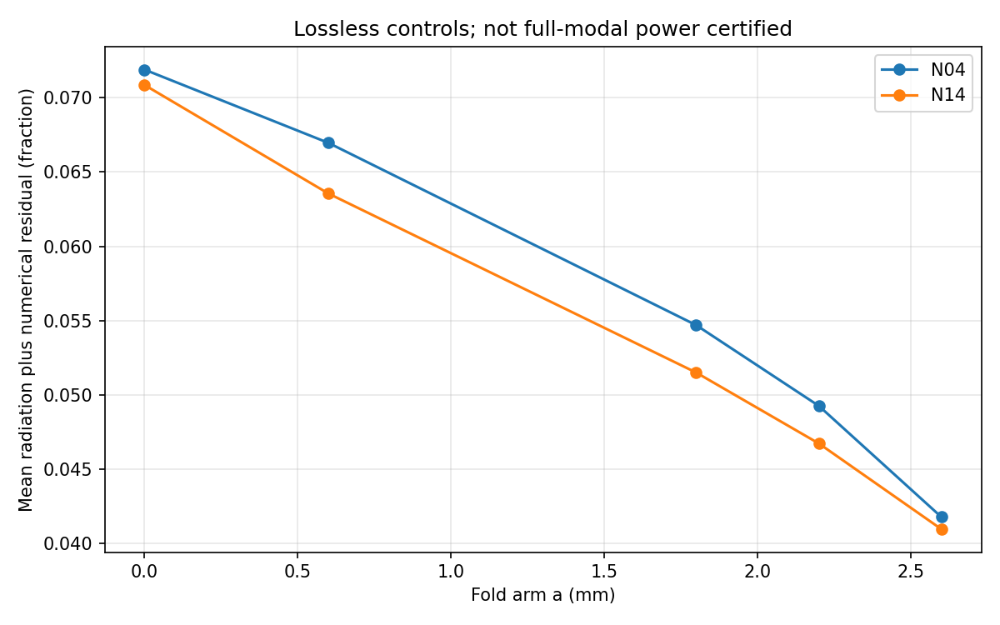
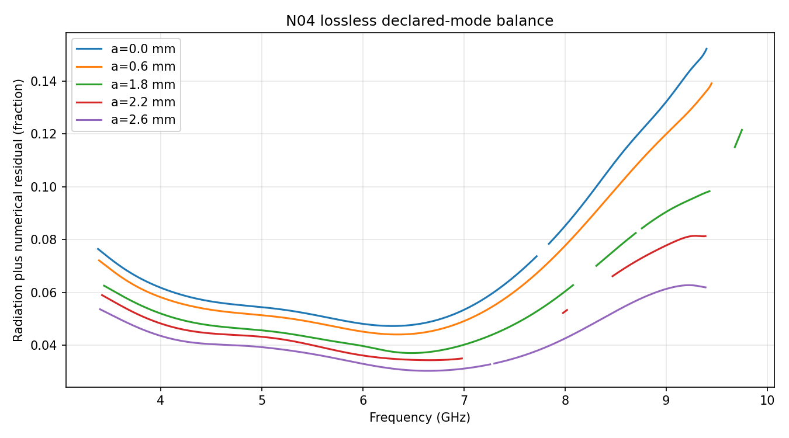
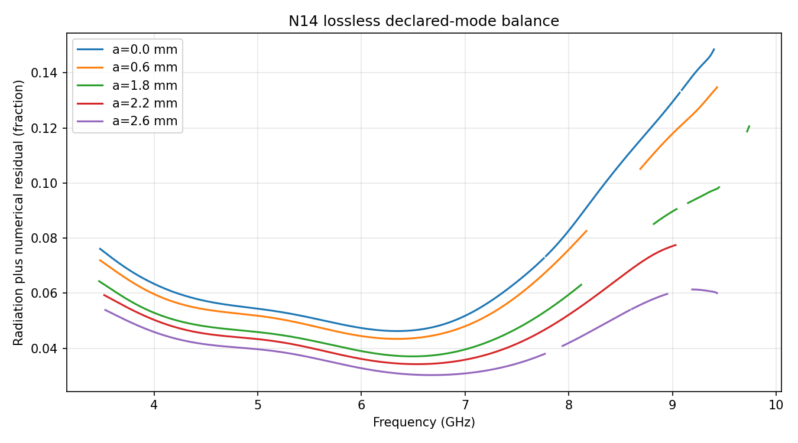

# R7 3R最终审核报告

八个新设计均达到R7研究可用点；加上4个既有点，共12个等纹波研究点。10个无耗和2个加宽基板对照均完成，数量条件通过。
同纹波带宽、预测评分与功率余量的结论按下列实测数据报告，不把研究可用点冒充硬−20 dB交付设计。3R已停止，未进入阶段4/5。

冻结折算到L=−20.3 dB后，a=0.6–2.2 mm的BW15*跨度：N04 44.84 MHz，N14 77.30 MHz。P1只在N04满足；不能概括为两家族都严格无带宽代价。
a=2.6相对a=1.8的BW15*代价：N04 138.35 MHz，N14 140.51 MHz，两家族均满足P2的50–150 MHz预测。直槽相对a=1.8更窄99.61、117.10 MHz；P3的110 MHz上限在N14略超。
以上是冻结名义斜率的点估计，完整上下限保留；接近50/110/150 MHz边界时，不能忽视斜率及约0.06 dB数值起伏。BWref*与BW15*分列，不把不同阈值的带宽混用。

本轮27几何、265次实际Analyze；阶段3累计33/42几何，全局133/187，累计实际请求1226。

## 可复核主表
见 [冻结口径完整报告](../final/REPORT.md)、[METRICS.json](../final/METRICS.json)。主表同时给原始BW15/BW20/BWref和冻结斜率折算、上下限。

## 四条预测（固定口径，不因结果修改）

### P1
```json
[
  {
    "family": "N04",
    "passed": true,
    "values": [
      6.305653351529502,
      6.3268299785019355,
      6.350496288247083,
      6.331587389926396
    ]
  },
  {
    "family": "N14",
    "passed": false,
    "values": [
      6.146728817548205,
      6.170455830257275,
      6.224030213306996,
      6.159087550845856
    ]
  }
]
```

### P2
```json
[
  {
    "family": "N04",
    "delta_GHz": 0.1383454634465524,
    "passed": true
  },
  {
    "family": "N14",
    "delta_GHz": 0.14050839126349324,
    "passed": true
  }
]
```

### P3
```json
[
  {
    "family": "N04",
    "delta_GHz": 0.09961414369525734,
    "passed": true
  },
  {
    "family": "N14",
    "delta_GHz": 0.11709648814706597,
    "passed": false
  }
]
```

### P4
```json
[
  {
    "family": "N04",
    "a": 0.0,
    "predicted": 0.362,
    "actual": 0.362,
    "passed": true
  },
  {
    "family": "N04",
    "a": 0.6,
    "predicted": 0.366,
    "actual": 0.366,
    "passed": true
  },
  {
    "family": "N04",
    "a": 2.2,
    "predicted": 0.449,
    "actual": 0.451,
    "passed": true
  },
  {
    "family": "N04",
    "a": 2.6,
    "predicted": 0.519,
    "actual": 0.554,
    "passed": false
  },
  {
    "family": "N14",
    "a": 0.0,
    "predicted": 0.322,
    "actual": 0.32,
    "passed": true
  },
  {
    "family": "N14",
    "a": 0.6,
    "predicted": 0.335,
    "actual": 0.327,
    "passed": true
  },
  {
    "family": "N14",
    "a": 1.0,
    "predicted": 0.337,
    "actual": 0.334,
    "passed": true
  },
  {
    "family": "N14",
    "a": 2.6,
    "predicted": 0.47,
    "actual": 0.47,
    "passed": true
  }
]
```

## 无耗控制：辐射加数值误差

采用原生广义S；Gamma与Zo联合判断传播，未知/非物理功率点不填零、不裁剪。包含端口模式截断、数值和边界不确定性，full_modal_power_certified=false。
|家族|a mm|主带有效/总频点|平均余量|余量最小|余量最大|
|---|---|---|---|---|---|
|N04|0.0|592/628|0.0718895169313713|0.047315547999034924|0.1522191739550024|
|N04|0.6|607/630|0.06696139514101697|0.04410943398904155|0.13916659032377976|
|N04|1.8|581/632|0.054699904222845326|0.03707826488813959|0.12153089031200781|
|N04|2.2|457/632|0.049270513893573654|0.034390071365908104|0.09299993422473396|
|N04|2.6|597/621|0.041791437843965336|0.030350919568831847|0.06277040920654087|
|N14|0.0|591/611|0.07085522373333042|0.04628368924277271|0.14851081803478194|
|N14|0.6|546/615|0.063553560104785|0.04344789091949797|0.13611562205170347|
|N14|1.8|523/628|0.05150942715758231|0.037093460354325036|0.1205960088661121|
|N14|2.2|552/614|0.04674165438550304|0.034273622364744405|0.07749918778126597|
|N14|2.6|551/602|0.040975114087734|0.030308246493994773|0.06137351726858009|





全部涉及模式2的S项最大模值在POWER_SUMMARY.json；其幅度不是传播功率。逐频Gamma、传播掩码、功率余量见各POWER.csv。

## 基板边界对照
```json
[
  {
    "case": "S3R7_N14_a0.0_WIDE__T1",
    "parent": "S3R7_N14_a0.0__T2",
    "geometry_unchanged": true,
    "original": {
      "central_GHz": 6.73,
      "D": -0.31689685125544287,
      "L": -20.298055127320332,
      "peaks": [
        -20.13960670169261,
        -20.456503552948053
      ],
      "tuned": true,
      "usable_for_law": true,
      "error_e": 0.6337937025108857,
      "mean_inner_peak_dB": -20.298055127320332,
      "signed_D_dB": -0.31689685125544287,
      "hard_design_peaks_pass": true,
      "BW15": 6.107176834244889,
      "BW20": 5.767115819809883,
      "BWref": 5.76723704167286,
      "BW15_star": 6.10693372515993,
      "BW15_star_range": [
        6.106904552069736,
        6.106962898250125
      ],
      "BWref_star": 5.766867515863724,
      "BWref_star_range": [
        5.76682861841013,
        5.766906413317317
      ]
    },
    "widened": {
      "central_GHz": 6.74,
      "D": -0.07231819002903705,
      "L": -20.27655030300182,
      "peaks": [
        -20.2403912079873,
        -20.312709398016338
      ],
      "tuned": true,
      "usable_for_law": true,
      "error_e": 0.6666666666666821,
      "mean_inner_peak_dB": -20.27655030300182,
      "signed_D_dB": -0.07231819002903705,
      "hard_design_peaks_pass": true,
      "BW15": 6.108930376136305,
      "BW20": 5.766348071794634,
      "BWref": 5.76781273056984,
      "BW15_star": 6.105999164011532,
      "BW15_star_range": [
        6.1056474185565595,
        6.106350909466506
      ],
      "BWref_star": 5.7633572881401856,
      "BWref_star_range": [
        5.762888294200223,
        5.763826282080149
      ]
    },
    "BW15_change_MHz": 1.7535418914160772,
    "L_change_dB": 0.021504824318512306,
    "D_change_dB": 0.2445786612264058
  },
  {
    "case": "S3R7_N14_a1.8_WIDE__T1",
    "parent": "S1_WS_01",
    "geometry_unchanged": true,
    "original": {
      "central_GHz": 6.73,
      "D": 0.08982869987249842,
      "L": -19.835520825594656,
      "peaks": [
        -19.880435175530906,
        -19.790606475658407
      ],
      "tuned": true,
      "usable_for_law": true,
      "error_e": 0.7741319573422405,
      "mean_inner_peak_dB": -19.835520825594656,
      "signed_D_dB": 0.08982869987249842,
      "hard_design_peaks_pass": false,
      "BW15": 6.282090110107664,
      "BW20": null,
      "BWref": 5.9976716546898645,
      "BW15_star": 6.224030213306996,
      "BW15_star_range": [
        6.217063025690916,
        6.2309974009230755
      ],
      "BWref_star": 5.909420611552849,
      "BWref_star_range": [
        5.9001310280647425,
        5.918710195040956
      ]
    },
    "widened": {
      "central_GHz": 6.73,
      "D": 0.07703372726056656,
      "L": -19.797914752503686,
      "peaks": [
        -19.836431616133968,
        -19.7593978888734
      ],
      "tuned": true,
      "usable_for_law": true,
      "error_e": 0.8368087458271904,
      "mean_inner_peak_dB": -19.797914752503686,
      "signed_D_dB": 0.07703372726056656,
      "hard_design_peaks_pass": false,
      "BW15": 6.277820839625273,
      "BW20": null,
      "BWref": 5.995890491674853,
      "BW15_star": 6.215060183688234,
      "BW15_star_range": [
        6.2075289049757885,
        6.222591462400678
      ],
      "BWref_star": 5.900494294650553,
      "BWref_star_range": [
        5.890452589700627,
        5.910535999600479
      ]
    },
    "BW15_change_MHz": -4.269270482391008,
    "L_change_dB": 0.03760607309096997,
    "D_change_dB": -0.012794972611931854
  }
]
```

## 数据身份、预算与停止
8个新设计为预登记前瞻调参数据，4个既有点为回顾数据；新尝试不得再当独立盲测。15个调参几何和12个对照各自入账，原阶段3的6个历史成本全部保留。
R7派发冻结中的plan_commit/plan_path旧兼容字段来自R6；实际新增授权由execution_revision=R7_3R、R7计划哈希和用户原文共同绑定，求解前提交为bc1b718。没有更改旧字段来伪造新的历史。
执行代码/输入/旧证据哈希未变化，每项发布早于求解；所有角色验收通过，最终扫频未改变网格，进程已正常释放；无hook、未启动阶段4/5。
AUDIT.json含每几何计费、网格、ΔS、发布提交及串行区间。TUNING_STEPS.json记录预测/实际变化与Broyden触发；未通过的中间尝试完整保留。

停止原因：R7第4.3节要求3R结束后提交等审核。后续前瞻点、硬−20dB交付和加密网格确认仍需后续方案，不擅自启动。
