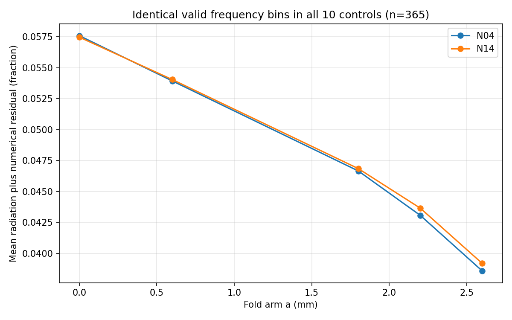

# 功率曲线覆盖率补充核对

原报告每条曲线的有效频点不同（主带有效比例约72%–97%），直接比较各自均值可能有频率选择偏差。这里保留原结果，另取10个无耗控制共同有效且都在各自主带内的同一组原生频点；不插值、不重拟合、不改传播判据。
共同有效频点365个，范围3.53–8.95 GHz；不是连续无缺口全频带。

|家族|a mm|同频点平均余量（1=100%）|
|---|---|---|
|N04|0.0|0.05759493|
|N04|0.6|0.05393495|
|N04|1.8|0.04665918|
|N04|2.2|0.04306750|
|N04|2.6|0.03857325|
|N14|0.0|0.05747439|
|N14|0.6|0.05404578|
|N14|1.8|0.04684866|
|N14|2.2|0.04365108|
|N14|2.6|0.03918010|

共同频点上两家族的余量都随折臂加长下降；与减少辐射边缘损耗的解释方向一致。但仍是辐射加数值误差，不是纯辐射，端口模完整性和场通量未认证。不能据此把full_modal_power_certified改为true。

完整逐频数据见CURVES.csv，原各自主带统计和缺口曲线仍保留在final_audit，不用这个事后覆盖检查替换冻结的原口径。
