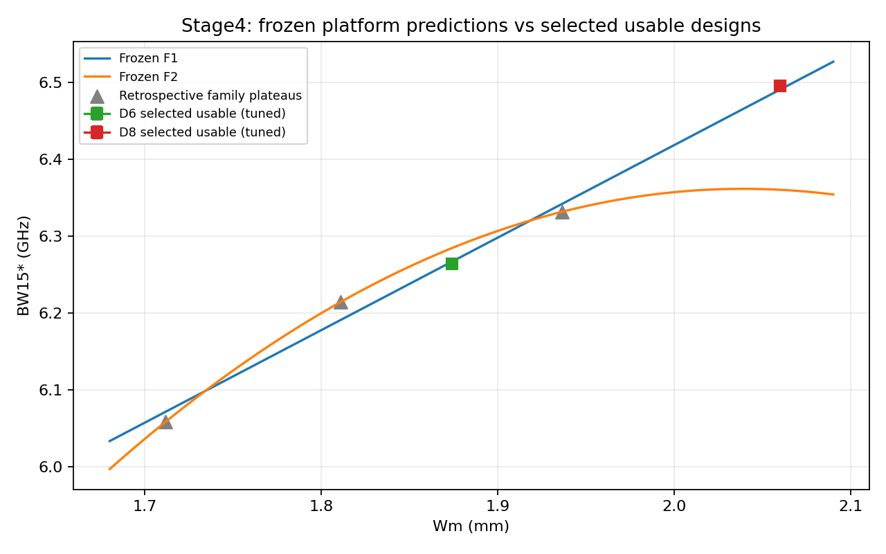
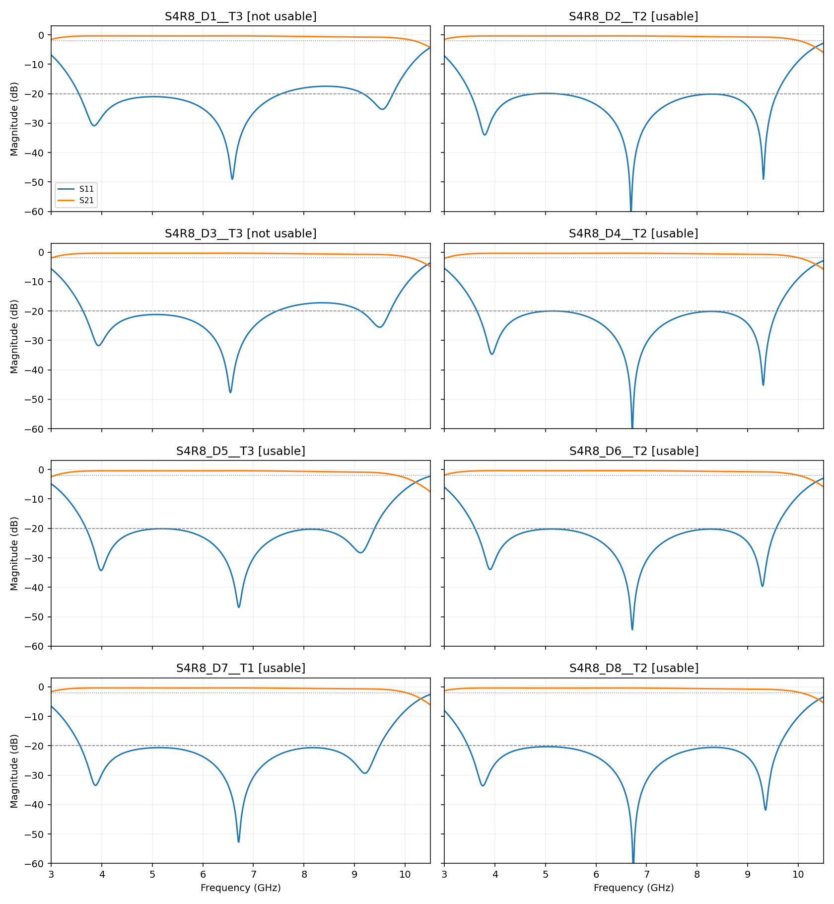

# R8 阶段4总结（2026-11-14，日本时间）

## 已完成，并停在阶段5之前

- 计划：claude/fold-bandwidth-plan @ 9f90b07；先完成R8-1并推送冻结27e8e2b，再按D1–D8顺序求解。
- 8个指定设计均完成有限流程；6个研究可用，D1/D3用满三次仍未调准，保留全部负例。
- 新增18/24几何、180次实际Analyze；累计151/187几何、1406次实际Analyze。
- 每几何7–12次实际Analyze；全18项数值通过，100721–104592单元，最大ΔS=0.0024561；真实14核、1组、串行，无hook。
- 全部求解已结束；无活跃HFSS/worker；本批STOP为完成待审核，不进入阶段5。

## 主要发现

1. **Wm=2.060（D8）仍能继续拓宽。** BW15*=6.494812 GHz，冻结线性平台预测6.490547、二次6.360062；更支持本范围内的线性支路，不能外推成无限线性增加。原生名义BW20=6.160889 GHz，尚非交付/加密/制造认证。
2. **Q1仍没有结论。** D1/D3的g=2.0是训练范围外；三次有限修正仍未成为等纹波可用点，不能拿其不平衡曲线判哪种代价假说正确，也不能断言物理不可达。
3. **Q2名义失败，Q3/Q4/Q5名义通过。** D7的BW15*=6.301874，比Q2上界6.29高约12 MHz；D5=6.013555、D6=6.263449。
4. **公式直接命中仍不可靠。** T1严格四项联合0/8，未见组合口径0/7；局部反馈调参得到6/8可用点。D6仅因冻结谷预测6.719869与实测6.75的误差30.13098 MHz，比30 MHz门槛多0.13098 MHz，而频率采样是10 MHz，须明确为边界情况，不与D1/D3的大幅失败混为一谈。
5. **D5不是未见组合独立检验。** 原训练含S2_E1_N08_a1.0__T1。T1六维几何新且先预测后求解，但(Wm,a,g)已见；初始R8-1漏了此审计，发现后单列披露，未事后删训练/改系数，也未追加替代点。

## 审核入口

- [完整中文报告](final/REPORT.md)
- [独立技术与原生CSV复算审计](final/AUDIT.json)（通过仅指执行/数值/来源，不指预测全过）
- [全部T1预测、实测与评分](final/T1_SCORES.json)
- [选中点与原始几何](final/SELECTED.json)
- [Q1–Q5评分](final/REVIEWER_SCORES.json)
- [D5角色披露](DATA_ROLE_DISCLOSURE.md)
- [R8-1离线拟合、整阶梯CV](OFFLINE_R8_1.md)
- [冻结授权与预算](freeze/BUDGET.json)
- 每项原生CSV/NPZ、Zo/Gamma、数值角色、S11/S21和实际看图ACK：results/。

## 保留限制

旧均匀数据及旧冻结结果未变。严格双峰-20 dB、固定完整目标窗、等纹波研究可用和最终制造认证不是同一口径。无耗功率认证没有新增。剩余额度不是追加授权；阶段5须审核后另定，本轮不派发。
