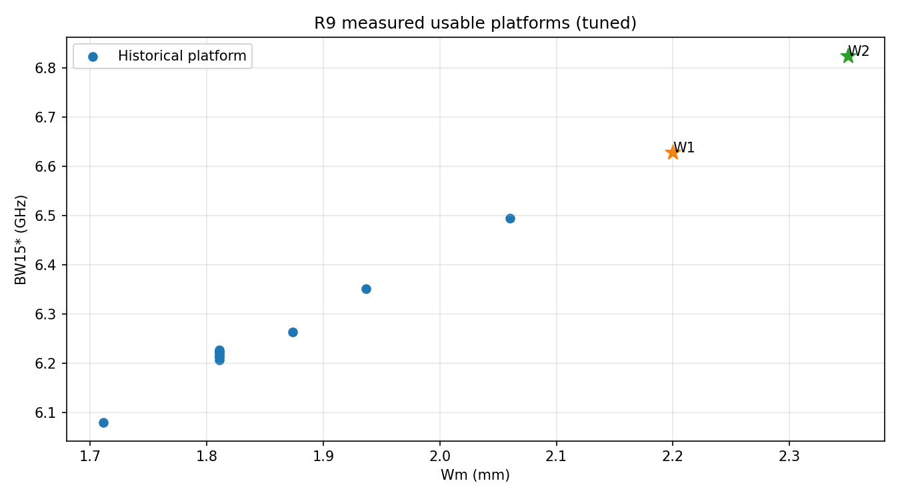
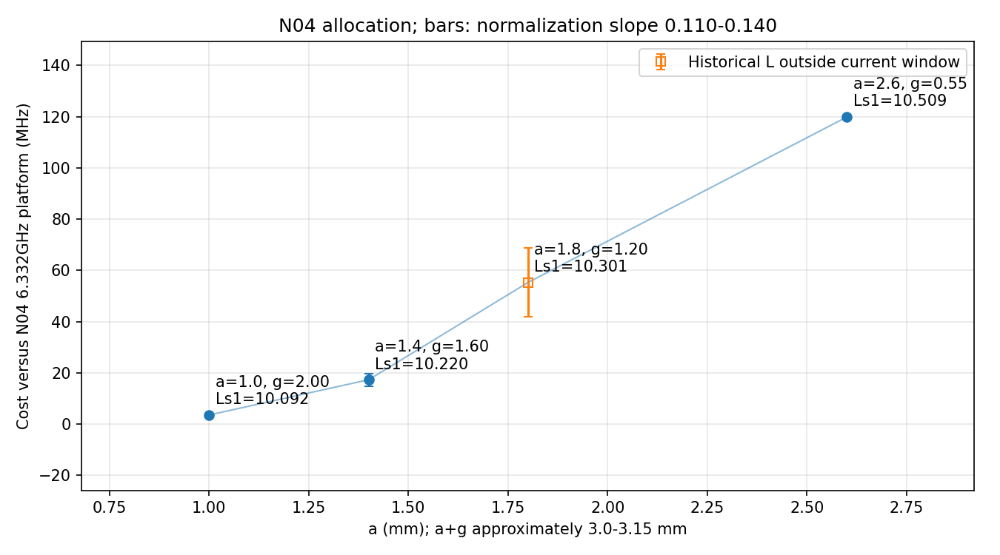
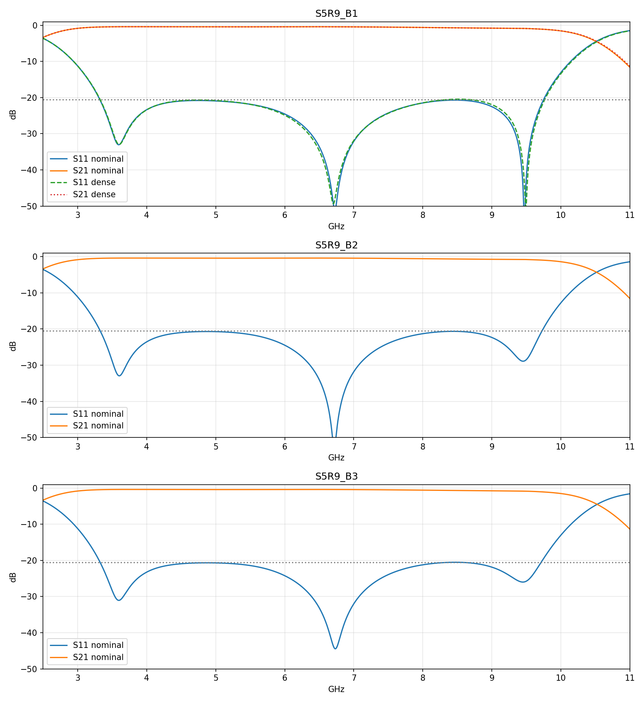

# R9 阶段5执行报告（中文）

## 一、总结

**R9 已执行完并停止，未进入阶段6。三个形状均达到名义交付目标；B1 的唯一密网格确认也通过。但 ±0.02 mm 联合线性公差估计不能保证 −20 dB，加工鲁棒性尚未解决。**

- 共使用 **22/26 个几何预算槽**（21个普通几何 + 1个同几何密网格确认），新增 **227 次实际 Analyze**；累计 **173/187**、**1633 次实际请求**。14核、1组、串行，无hook。
- **5A：5/6 研究可用**。W1/W2 的 BW15* 为 **6.627842 / 6.824813 GHz**；按预注册门槛，2.06–2.35 mm 段没有出现所定义的饱和。W3用满三次后中心谷6.68 GHz，偏差40 MHz，不入可用平台或5B宽度选择。
- **N04分配阶梯支持“多分给g更便宜”**：D1c、S1相对6.332 GHz平台的代价为 **3.566、17.301 MHz**；Q7通过。这是近似同折叠量的相关性，不是严格同跨度因果实验，更不是单凭带宽证明纯辐射损耗。
- **Q8：R9冻结的a阈值模型本轮预测胜出**，新可用点RMSE **16.603 MHz**；第二名端头净距33.435 MHz。满足≤25 MHz且领先≥30%的规则，但本轮可用点a≤1.8，未检验其2.39 mm拐点以上机制。
- **T1四门槛联合 0/7**。完整几何反解仍依赖局部HFSS反馈；不能宣称公式一次命中或已有通用神经网络逆向器。

|名义交付|两内峰 dB|中心 GHz|BW20 GHz|BW20内最差S21 dB|
|---|---|---|---|---|
|B1|-20.7958 / -20.6866|6.73|6.454922|-1.1090|
|B2|-20.6903 / -20.6398|6.72|6.426667|-0.9490|
|B3|-20.6622 / -20.5099|6.73|6.418340|-1.0347|

B1确认：**208,845单元**、ΔS=**0.0017234**，两个内峰 **−20.6697 / −20.4308 dB**，均≤−20.0；相对名义峰变化 **+0.1261 / +0.2558 dB**，Q10通过。确认后BW20 **6.466249 GHz**，增加 **11.326 MHz**；中心谷6.73→6.70 GHz。

固定a/g、与1b一致的参数口径下，Ws/Lm/Ls1各±0.02 mm、三者联合8个角点的最坏内峰依次 **−19.5955、−19.4237、−19.3851 dB**，**0/3保证−20 dB**。这不是加工认证。

## 二、执行顺序、冻结和预算

R9-1冻结并推送 `29a425c` 后才启动W1；5A按 W1→W2→W3→D1c→D3c→S1 执行。W2相对W1增长196.970 MHz，满足W3≥120 MHz的放行条件。D1c/D3c在T4即达到首个可用点，没有使用T5。
5A结束后，R9-2重拟合和三项T1于 `1d8e024` 冻结并推送，再按 B1→B2→B3 执行；最后仅对B1同一几何做一次密网格确认。Wm*=2.35 mm；B3选择N04阶梯最高BW15*的a=1.0、g=2.0 mm。
B1的形状元组已在W2训练中出现，但完整几何/目标纹波不同，因此只是求解前的新完整几何预测，**不称作未见元组盲测**。B2/B3为新宽度组合。所有T1永久保留，不用调参后结果回填其预测。

|阶段|几何预算槽|实际Analyze|
|---|---|---|
|起始累计|151|1406|
|5A|13|129|
|5B三个名义形状|8|85|
|B1密网格确认|1|13|
|本轮合计|22|227|
|累计|173|1633|

普通几何每项≤14请求；确认解13/20请求。所有几何预算、发布、进程角色、原生收敛历史和清理证据逐项保存。剩余槽位不转作新的授权。

## 三、5A可用点和T1前瞻检验

BW15* = BW15 − 0.125×(L+20.3) GHz；它不是硬BW20。未调准点保留原始曲线，不用于规律评分。

|设计|选定案例|中心 GHz|D dB|L dB|BW15* GHz|研究可用|
|---|---|---|---|---|---|---|
|W1|S5R9_W1__T2|6.72|0.0772|-20.2805|6.627842|是|
|W2|S5R9_W2__T3|6.72|0.3049|-20.3659|6.824813|是|
|W3|S5R9_W3__T3|6.68|0.1562|-20.4227|不评分|否|
|D1c|S5R9_D1c__T4|6.72|-0.3105|-20.2865|6.328434|是|
|D3c|S5R9_D3c__T4|6.75|-0.2121|-20.2192|6.172797|是|
|S1|S5R9_S1__T3|6.73|-0.0089|-20.1364|6.314699|是|

D3c在6.75 GHz边界，沿用既定含边界的R7门槛；未为追求更居中而追加一次。W3中心偏低不是数值失败或物理不可达结论。

T1评分门槛：谷误差≤30 MHz，D≤0.7 dB，L≤0.3 dB，BW15≤40 MHz。主带宽模型在R9-1冻结为span；BW15误差按计划使用实测L条件化，不重新拟合。完整五模型预测均见 [T1_SCORES.json](T1_SCORES.json)。

|T1案例|谷 预测/实测 GHz|D 预测/实测 dB|L 预测/实测 dB|span BW15误差 MHz|四门槛联合|
|---|---|---|---|---|---|
|S5R9_W1__T1|6.7200 / 6.65|-0.001 / 0.972|-20.303 / -20.265|35.300|否|
|S5R9_W2__T1|6.7192 / 6.59|0.017 / 1.523|-20.287 / -20.147|90.614|否|
|S5R9_W3__T1|6.7186 / 6.50|0.023 / 2.187|-20.291 / -19.988|173.050|否|
|S5R9_S1__T1|6.7204 / 6.52|-0.010 / 5.573|-20.309 / -20.097|-207.046|否|
|S5R9_B1__T1|6.7191 / 6.72|0.012 / -0.232|-20.655 / -20.494|49.431|否|
|S5R9_B2__T1|6.7211 / 6.69|-0.024 / 0.058|-20.663 / -20.987|58.753|否|
|S5R9_B3__T1|6.7214 / 6.46|-0.021 / 6.152|-20.652 / -19.884|-165.814|否|

D1c/D3c接续原T1–T3的Broyden更新，T4/T5是调参，不是新的独立T1。5B交付选定点也均为调参所得。

## 四、Q6–Q10预注册评分

- **Q6通过可评分部分**：W1、W2均在预测区间内；W2≥6.75 GHz，不触发“2.06–2.35之间开始饱和”。W3不可判，不用不平衡/偏移数据替代。
- **Q7通过**：D1c/S1代价均≤50 MHz。四个N04阶梯点a+g约3.0–3.15，不严格等跨度。
- **Q8胜出：a阈值模型**。它是看过阶段4后在R9冻结的模型，不是R8或R7-only的旧模型。不能把本次带宽预测胜出解释为完整反解已成功，也不能据此证明唯一物理原因。

|冻结代价模型|5A五个可用点RMSE MHz|
|---|---|
|a|16.603|
|tip|33.435|
|sum|50.352|
|rho|55.582|
|span|67.480|

- **Q9通过**：同Wm等纹波平台6.824813 − B1名义BW20 6.454922 = **0.369891 GHz**，在0.30–0.40区间。
- **Q10通过**：最大单峰网格变化0.255825 dB≤0.35，且两个密网格内峰均≤−20.0 dB。它支持所规定的0.5 dB名义余量，但不替代B2/B3各自确认或加工公差认证。

|N04案例|a mm|g mm|Ls1 mm|BW15* GHz|代价 MHz|数据身份|
|---|---|---|---|---|---|---|
|S5R9_D1c__T4|1.0|2.00|10.092|6.328434|3.566|新调参|
|S5R9_S1__T3|1.4|1.60|10.220|6.314699|17.301|新调参|
|S2_E2_N04_g1.20__T3|1.8|1.20|10.301|6.276736|55.264|归档参考，L超出当前R7窗口|
|S3R7_N04_a2.6__T3|2.6|0.55|10.509|6.212151|119.849|历史调参|

旧g=1.2点的L=−21.1951 dB：在原阶段2及R9计划中是已接纳的历史候选，但不满足后来R7的L窗口。这里保留为归档归一化参考，**不冒充新R7可用点**。图中空心点及误差条给出0.110–0.140归一化斜率的变化，不是制造置信区间。R9-2构造器比较了全部四个历史/新候选；该口径差异不改变D1c为最高者。五个新可用点的Q8评分不包含这条旧点。

## 五、三项交付尺寸及曲线

所有尺寸单位mm；Wm/a/g在各形状调参中固定，未改变P/R去换另一个设计。基板半宽15 mm；完整原生CSV和每次输入见上级results、pre_solve目录。

|形状|Wm|Ws|Lm|Ls1|Ls2|Ls3|a|g|端头到微带净距|两端头横向净距|
|---|---|---|---|---|---|---|---|---|---|---|
|B1|2.350|0.554|6.515|12.508|1.658|2.354|1.8|0.55|2.725|7.800|
|B2|2.350|0.619|6.445|11.705|1.788|2.819|2.2|0.55|1.859|6.067|
|B3|2.350|0.542|6.555|10.408|3.084|1.542|1.0|2.00|2.487|7.324|

相对B1，B2/B3的名义BW20分别少28.256/36.582 MHz，约0.44%/0.57%；不是数学上“完全不掉带宽”。其跨度更紧凑，实际Ls1见表。B3最差内峰−20.50995 dB，只比−20.5门槛低0.00995 dB，应保留完整精度，不将它描述为额外裕量充足。

## 六、唯一B1密网格确认

|项目|名义网格|密网格|密−名义|
|---|---|---|---|
|单元数|100740|208845|108105|
|ΔS|0.0011771|0.0017234|均满足各自门槛|
|低频内峰 dB|-20.795778|-20.669701|0.126076|
|高频内峰 dB|-20.686649|-20.430824|0.255825|
|中央谷 GHz|6.73|6.70|-0.03|
|BW20 GHz|6.454922|6.466249|0.011326|

几何与选定B1逐尺寸完全相同；只改变网格/ΔS设置，扫频仍为原插值方式，没有添加直接频点或基板加宽确认。B2/B3没有独立密网格验证，其−20dB推断依赖本B1确认和0.5dB名义余量。

## 七、离线±0.02 mm公差

采用各设计自身最后可获得的局部J：B1未触发更新，使用初始J；B2/B3按实际触发条件做Broyden更新，不伪造一次更新。主口径与1b相同：固定a/g，δLc=δLs1+2δWs，Ls2/Ls3随派生关系调整。以下为线性估计，不提交新求解。

### B1
|单独扰动|中央谷变化 ±MHz|低内峰变化 ±dB|高内峰变化 ±dB|最坏绝对内峰 dB|
|---|---|---|---|---|
|Ws ±0.02|12.640|0.3875|0.6557|-20.0310|
|Lm ±0.02|45.785|0.3192|0.2914|-20.3952|
|Ls1 ±0.02|10.723|0.1088|0.1441|-20.5426|
三变量同时取8个角点：最坏内峰 **-19.5955 dB**；中央谷范围 **6.66085–6.79915 GHz**，不能保证−20dB或原中心窗。
J给出的Ws每0.01mm两内峰灵敏度：[0.1938, 0.3278] dB；归档1b实测线性拟合：[0.1027, 0.3774] dB。两者口径一致但来自不同宽度/形状，不将其强制校准为相同数值。

### B2
|单独扰动|中央谷变化 ±MHz|低内峰变化 ±dB|高内峰变化 ±dB|最坏绝对内峰 dB|
|---|---|---|---|---|
|Ws ±0.02|12.698|0.4785|0.7906|-19.8492|
|Lm ±0.02|45.814|0.2720|0.3614|-20.2784|
|Ls1 ±0.02|10.689|0.1627|0.0641|-20.5276|
三变量同时取8个角点：最坏内峰 **-19.4237 dB**；中央谷范围 **6.65080–6.78920 GHz**，不能保证−20dB或原中心窗。
J给出的Ws每0.01mm两内峰灵敏度：[0.2393, 0.3953] dB；归档1b实测线性拟合：[0.1027, 0.3774] dB。两者口径一致但来自不同宽度/形状，不将其强制校准为相同数值。

### B3
|单独扰动|中央谷变化 ±MHz|低内峰变化 ±dB|高内峰变化 ±dB|最坏绝对内峰 dB|
|---|---|---|---|---|
|Ws ±0.02|13.657|0.4199|0.7237|-19.7863|
|Lm ±0.02|45.787|0.3192|0.2916|-20.2184|
|Ls1 ±0.02|10.207|0.1252|0.1095|-20.4004|
三变量同时取8个角点：最坏内峰 **-19.3851 dB**；中央谷范围 **6.66035–6.79965 GHz**，不能保证−20dB或原中心窗。
J给出的Ws每0.01mm两内峰灵敏度：[0.2099, 0.3618] dB；归档1b实测线性拟合：[0.1027, 0.3774] dB。两者口径一致但来自不同宽度/形状，不将其强制校准为相同数值。

**口径边界**：若实际蚀刻只改变Ws而固定Ls2/Ls3，δLc=δLs1−4δWs，同时δa=−δWs、δg=−2δWs。现有J缺独立a/g导数，不能给出完整加工最坏界。[TOLERANCE.json](TOLERANCE.json)另列忽略未知a/g项的条件投影，明确不作认证。不能把固定a/g参数公差表当成所有制造误差。

## 八、数值、独立复算与披露

- 22/22原生CSV按既定R2规则独立复算，中央谷、D、L、BW15/BW20最大差 **0**，严格1e−9检查通过；实际看图ACK、14核1组角色、串行无重叠、发布先于求解、原生Lm/Wm回读和旧冻结哈希均通过。详见 [AUDIT.json](AUDIT.json)。
- 旧独立审核辅助函数在B3 T1遇到小局部波纹，先选8.50 GHz局部极大而非两主谷之间真正的8.84 GHz最大内峰。新独立重放器按原R2“相邻显著谷之间最大值”复算，未修改任何原结果、判据或T1预测。差异原样保留在 [LEGACY_REPLAY_DIFFERENCES.json](LEGACY_REPLAY_DIFFERENCES.json)。
- R9-2离线目录创建和旧字段兼容问题在派发前由版本化freeze_5b_v2.py解决；旧文件保留，未消耗Analyze。重复发布B2证明被独占写保护挡下，随后复用原有效证明，没有清理标记、覆盖证明或重复求解。
- 原始status/decision中的`delivery=false`是通用占位字段，正式名义判据看`delivery_pass`及明细；确认解另按R9的−20.0 dB规则，不能把普通−20.5配方检查当作确认判定。详见 [字段说明](../DATA_SCHEMA_DISCLOSURE.md)。
- 默认研究测试11项、R9离线测试11项、独立CSV重放测试3项、旧归档8765文件校验无误；最终验证记录和文件清单见上级FINAL_VERIFICATION.json、FINAL_MANIFEST.json。

## 九、停止与接续边界

本轮已正式写入STOP，所有本轮worker/自建AEDT已退出，无新仿真、无自动接续、无hook，**未授权阶段6**。W3仅保留未调准，不扩额；确认通过后不追加调参。未来若继续加工鲁棒优化、直接频点/其它形状独立密网格确认、通用理论P/R或神经网络逆向器，需新计划/授权。
反演P_eff/R_eff等细节保存在SELECTED.json及各项提取文件，但它们是电路拟合量，不是独立理论参数唯一性或完整物理损耗认证。旧均匀数据与旧闭账批次均未操作。
